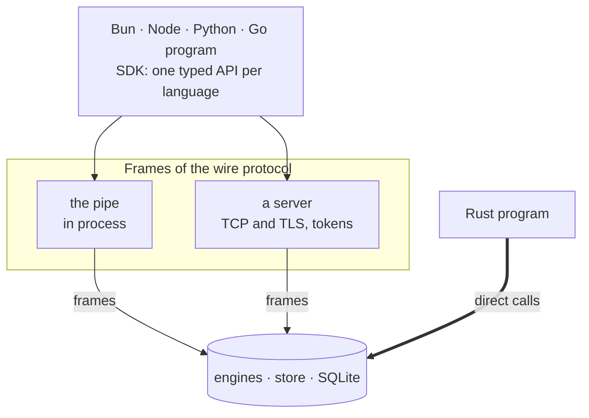

# Writing the docs

The guides in `docs/` are what people and AI agents read to build on
TinyStore. Every page has to work in two ways:

- **As part of a book.** The site's previous and next links follow the order
  of `docs/README.md`, so readers can go through the docs from start to
  finish. Each section starts with the common case and ends with the details.
- **As a single page.** Many readers arrive from a search, a link or an
  agent's `llms.txt`, and see nothing but this one page. It must make sense on
  its own.

> **Every part is written**: the handbook in `docs/handbook/`, a guide an
> engine in `docs/guides/<engine>/`, and the reference generated into
> `docs/reference/`. A page changes with the code it describes, in the same
> commit, and is checked against the code, never against memory.

A guide only describes what is built. The old design documents in research's
`tinystore/design/` are a good source of facts and examples, but never copy
their sentences: the guides use the plain voice described below. Read this
file to learn how to write a page, and check the sources in
[Where the facts are](#where-the-facts-are) for what to write.

## Where a page goes

`docs/README.md` is the table of contents and the site's sidebar. Each `##`
heading is a section, and each list item is a page, in reading order. An item
without a link is a page that hasn't been written yet, and the site shows it
greyed out. To add a page:

1. Create the file in its section's directory, using the table below.
2. Turn its item into a link: `- Quotas` becomes `- [Quotas](kv/quotas.md)`.
3. The page's address is its path: `docs/kv/quotas.md` becomes
   `/docs/kv/quotas`, and an engine's overview `docs/kv/README.md` becomes
   `/docs/kv`.

| Section            | Files                             | What its pages cover                                                                           |
|--------------------|-----------------------------------|------------------------------------------------------------------------------------------------|
| Start              | `docs/handbook/start/`            | why TinyStore, a first store, the directory and the ways to reach it, the chat the book builds |
| Building the chat  | `docs/handbook/chat/`             | one chapter per engine, each adding one capability to the chat                                 |
| Under the hood     | `docs/handbook/inside/`           | how a write, a job, packing and search work, and why they were built that way                  |
| Beyond one machine | `docs/handbook/nodes/`            | the server, nodes and copies, a home that dies                                                 |
| Production         | `docs/handbook/production/`       | what TinyStore promises by contract, every limit, running it                                   |
| an engine's guides | `docs/<engine>/`                  | after the book: `README.md` the overview, then one page per feature a reader would search for  |
| Reference          | `docs/reference/`, `docs/wire.md` | the generated API pages, and the wire protocol last, for people who write a client             |
| Releases           | `docs/releases/`                  | the index, then a page per version, newest first: what it adds and renames, with code          |

A feature gets its own page if a reader would search for it by name, such as
Sessions, Quotas, Once or Steps. If a page needs more than six sections, split
it into two features. Don't add front matter, because GitHub shows it as a
table.

## The shape of a page

1. **`# Title`**: the name a reader would search for. `Quotas`, not
   `Several windows per key`.
2. **The lead**: one paragraph of two or three sentences that says what the
   feature does and when to use it, and names the engine. The site shows it
   under the title, in search results, in link previews and in `llms.txt`, so
   it has to make sense on its own.
3. **The shortest complete code** that does the job, in all four languages,
   near the top of the page. The first code block opens everything the page
   uses. Later blocks reuse those names, and the text says so.
4. **Sections that answer the reader's next questions**, from the common case
   to the edge cases: how to use it, what it guarantees, what happens when it
   fails, and what to watch out for. Write each heading as a task or a
   question, such as `## Refund uses` or `## What a crash loses`. Headings
   are also link anchors: if you rename one, the build tells you which links
   to fix.
5. **`## Limits and defaults`**: a table, if the feature has any.
6. **`## Why this design?`**: in a chapter of the book, the decisions a
   reader would not guess, each a bold question and a paragraph: what the
   obvious alternative was, what goes wrong with it, and what TinyStore does
   instead. A newcomer skips it; an engineer reads it first. A number in it
   carries its environment and its report, as everywhere.
7. **`## See also`**: the next pages to read, and the design document in
   research for why it works this way.

Use a callout only for something that can lose data, surprise the reader or
stop a program, such as a limit, a rejected value or an operation that is not
atomic. Never use one for emphasis. Most pages need one callout or none.

## Code first

The code tells the story, and the text explains it. A reader should be able
to skim a page by its code blocks alone and still learn how to use the
feature. Getting started is the model.

- **Start each section with code**, or with one short sentence that leads into
  it. Explain after the code, in a few sentences.
- **Show behaviour in the code itself.** Put the result in a comment next to
  the call: `await codes.take('K7Q2') // undefined: a second click finds nothing`.
  A comment like that replaces a paragraph.
- **Prefer a small example over a description.** If a rule can be shown with
  three lines of code, show the code and state the rule in one sentence.
- **Use real-looking values**: a user's id, an email address, a code such as
  `K7Q2`. Avoid `foo`, `bar` and `x`.
- **Keep text between code blocks short.** Two or three sentences are usually
  enough. If a section needs more, the feature probably needs another example.

## Voice: plain developer English

Write the way good developer documentation is written, such as Stripe's,
Bun's or grammY's: simple, direct sentences that a reader whose first language
is not English understands on the first read.

The repository's AGENTS.md, its code comments and the old design documents
use a dense, literary style. That style is fine for contributors, but it is
wrong for the guides. Don't copy it.

**Do:**

- Address the reader as "you". Use the present tense, and the imperative for
  steps: "Call `allow` before each action."
- Put one idea in each sentence, usually 10 to 20 words. Split any sentence
  that is longer than 25 words or chains several clauses.
- Use subject, verb, object, with the actor as the subject: "`take` returns
  the value and deletes the key."
- Keep "that", "which" and "who" in relative clauses: "the limits that a plan
  sets".
- Use plain connecting words: "because", "so", "if", "when", "for example",
  "instead".
- Use common words: "sets", "stores", "contains", "deletes", "fails",
  "accepts".
- Say "per": "one page per feature", "100 messages per week".
- Use a list for three or more parallel items, and a table for values that
  differ between languages.
- Describe results literally: "`allow` returns `ok: false`", "it fails with a
  conflict error (`ErrConflict` in Go, `ConflictError` in Bun and Python)".
- Show a scenario first, then the code, then the rule behind it.
- Make the "wow" a plain statement of a guarantee: "If a user clicks the link
  twice, only one sign-in succeeds."
- Say what a feature doesn't do, in one sentence, and what to use instead.

**Don't:**

- Drop "that" or "which": not "the limits a paid plan states".
- Use "a X a Y" to mean "per": not "one job a key", not "a page a feature".
- Chain clauses with colons and semicolons. Use at most one colon per
  sentence, only before a list, an example or code, and no semicolons.
- Use "since" or "as" to mean "because".
- Make an abstract noun the subject when a person or a call acts: not "a use
  counts in every window or in none", but "`allow` counts the use in every
  window, or in none of them".
- Write aphorisms or rhetorical rhythm: not "a lease is its attempt", not
  "one call opens it, one call closes it, one budget bounds it".
- Use unusual verbs where a plain one exists: "states", "names", "holds" or
  "takes" when you mean "sets", "identifies", "contains" or "accepts".
- Use marketing words or filler: "simply", "just", "easy", "powerful",
  "seamless", or exclamation marks. Phrases such as "for example" or
  "note that" are fine when they help the reader.
- Describe anything that isn't built as if it works.

A number must come with its environment, meaning the machine and versions,
and a link to the report that measured it. Otherwise, leave it out.

Before and after, from the first drafts of these docs and from the design
documents:

| Dense                                                                                                                                                       | Plain                                                                                                                                                                                                                                        |
|-------------------------------------------------------------------------------------------------------------------------------------------------------------|----------------------------------------------------------------------------------------------------------------------------------------------------------------------------------------------------------------------------------------------|
| It is the kv engine's answer to the limits a paid plan states: a use counts in every window or in none.                                                     | Quotas are part of the KV engine and are designed for the limits of paid plans. `allow` counts a use in all windows, or in none of them.                                                                                                     |
| `enqueue` returns once the job is on disk, so a job survives the process dying right after it.                                                              | `enqueue` returns after the job is saved to disk, so the job survives even if the process crashes right after.                                                                                                                               |
| Running until idle returns once no job is due, which suits a script or a test; a server runs `work` for as long as it runs.                                 | With `untilIdle`, `work` returns as soon as no jobs are due. This is useful in scripts and tests.                                                                                                                                            |
| Expired is absent to every operation. `Get`, `Has` and `Scan` do not see it, `SetIfAbsent` claims it, and `Add` starts again from zero.                     | When a key expires, TinyStore treats it as deleted. `get` returns nothing, `setIfAbsent` can write the key again, and a counter restarts from zero. You don't need a cleanup job.                                                            |
| A lease is its attempt. Settling a job names the attempt it claimed; one whose lease ended and whose job another worker has claimed since is `ErrConflict`. | When a worker claims a job, it gets a lease for a limited time. If the worker stalls and the lease runs out, another worker can claim the job. The first worker's late acknowledgement then fails with a conflict error and changes nothing. |
| A page ends where it can prove it is whole.                                                                                                                 | A page never splits records that have the same timestamp. The next page starts exactly where the previous one ended.                                                                                                                         |

Before you finish a page, read it aloud. If you have to read a sentence twice,
rewrite it.

## Code in four languages

Code blocks written one after another, with nothing between them, become one
block with a tab for each language. The site remembers the reader's choice on
every page.

````md
```ts
const ai = store.quota('ai', { daily: '100/1d', weekly: '300/7d' })
```

```python
ai = store.quota("ai", daily="100/1d", weekly="300/7d")
```

```go
ai, err := kv.OpenQuota(store, "ai", kv.Window("daily", 100, 24*time.Hour), kv.Window("weekly", 300, 7*24*time.Hour))
```

```rust
let ai = store.quota("ai").window("daily", 100, Duration::from_hours(24)).open()?;
```
````

- `ts` is the tab for Bun and Node, `python` for Python, `go` for Go and
  `rust` for Rust. The switch always shows them in the order Bun, Python, Go,
  Rust.
- **Every call in a block is checked against the API reference.** The site
  follows each chain from `store`, from a variable an earlier block of the
  same language assigned, from a Rust type's `Type::new` or a Go package's
  `kv.OpenQuota`, and links each call it resolves to its reference page,
  where a click opens its signature. A call on a type the reference knows
  that it does not list fails the build, so an example cannot use an API that
  is gone. A call on a variable whose type the page never shows is left plain:
  open a handle in the page's first block so that its calls are checked.
- `title="…"` gives a block a file name, and several titled blocks of one
  language become files of one block. Leave the title off a single snippet.
  Two untitled blocks of the same language stay two separate blocks.
- A shell command joins a language's tab with `for`: ` ```sh for=bun `.
- Lines that a logger prints on a terminal go in a ` ```log ` fence. The site
  colours them as the console does: the time and `key=` dim, the level in its
  colour, the stream cyan. GitHub shows the fence as plain text.
- **Every block shows all four languages.** If one is missing, the page says
  why, for example because only Go declares a schema from structs. A reader
  who chose Python and only finds Go has learned nothing.
- **Use the same names for handles on every page**: `store` for the store and
  `db` for an SQL database, in every language. Everything else opens from
  them, as each engine's guide shows.
- **In Go, check the errors that the page is about**, and leave the others as
  plain `err` assignments, like the package READMEs do. A short tour may start
  its Go block with `// errors left out`.
- **In the text, describe the idea instead of one language's spelling**, because
  `with` and `labels` are the same idea. Where the page introduces an option,
  give its spellings once: `defaultTtl`, `default_ttl`, `DefaultTTL`, `default_ttl`.
- **Write durations the way each language does**: `15*time.Minute` in Go,
  `Duration::from_mins(15)` in Rust, `'15m'` in Bun and Python. A bare number
  means milliseconds in Bun and seconds in Python.
- **Run the code if you can.** A complete program on a page, like the one in
  Getting started, should be one you have run in all four languages.

## A release's page

A version gets its page before its release is dispatched, written from what
`bun tools/release.ts --version vX.Y.Z --notes-only --out dist` lists, in the
commit that adds its item to the Releases part of `docs/README.md`, under the
index and above the version before. The release's notes on GitHub link to the
page when the commit it is built from carries `docs/releases/vX.Y.Z.md`.

- **`# TinyStore X.Y.Z`**, then a lead that says when it came out and what it
  brings, in a few plain sentences.
- **A list of what it brings**, grouped by engine: `- **Metrics**`, and under
  it an item each, `- [Title](#section): what it does`. The site draws a row
  per engine, its name on the left and each item a line, a link to its
  section.
- **A `WARNING` callout** when a change can break a build, and what to change
  as a ` ```diff ` fence, whose rows the site tints and whose bar it leaves out.
- **A section for each item**, its shortest code in four languages and a
  link to the guide that has the details.
- **`## Changed names`**, the old call above the new one in each language;
  then `## Fixes`, `## Faster` and `## Install`, plain lists and the
  install line of each language.

Only the newest release's calls are checked against the reference: an older
page shows the API of its own version, and its calls are linked where they
still exist.

## Scenes

A scene is a short animation of a real situation, played beside the code that
handles it: a buyer double-clicks "Pay", a worker crashes mid-email. Write it
as text in a ` ```scene ` fence. GitHub and agents read the text; the site
plays it, marks the code's line each step runs, and turns it on its side on a
phone.

````md
```scene
code ts
  const charges = store.once<Receipt>('charges', { keep: '1d' })
  return charges.run(key, () => stripe.charge(order, key))
end
actor buyer  "Buyer"  at 8,50  icon=user
actor kv     "kv.db"  at 50,50 icon=database
actor stripe "Stripe" at 92,50 icon=credit-card
link buyer kv
link kv stripe
set stripe "charged: 0"

step "The buyer clicks Pay twice." line=2
  send buyer -> kv "run key-7f"
  & send buyer -> kv "run key-7f" ghost
step "Stripe charges the card once." line=2
  send kv -> stripe "charge"
  set stripe "charged: 1"
  send stripe -> buyer "receipt" color=ok
```
````

| Line                                     | What it does                                                                 |
|------------------------------------------|------------------------------------------------------------------------------|
| `code ts` … `end`                        | the program the scene plays, highlighted, its calls linked to the reference  |
| `actor <id> "<label>" at x,y icon=…`     | who is on stage, in percent of the stage; icons are `src/lib/scene/icons.ts` |
| `link a b`, `cut a b`, `unlink a b`      | a cable between two actors, cut, or taken away                               |
| `set a "…"`, `add a "…"`, `strike a "…"` | an actor's line of state: replaced, appended, crossed out                    |
| `mark a home`, `copy`, `down`            | a badge: a home with a halo, a copy, a server cut off                        |
| `step "<caption>" line=3-4`              | a caption, and the code's lines the step runs                                |
| `send a -> b "<label>"`                  | a packet along an arc; `color=ok`, `color=bad`, `lost`, `ghost`              |
| `say a "…"`, `pulse a`, `wait 400`       | a word beside an actor, a ring, a pause                                      |
| `&` before an action                     | runs it with the action before it                                            |

### When a page gets a scene

A scene costs the reader half a minute, so it has to show what code and a
sentence cannot. A section gets one when all three hold:

1. **Something happens over time between two or more parties**: requests at
   once, a worker and a queue, a home and its copies. One call that returns a
   value is a code block with its result in a comment.
2. **The outcome is a guarantee the reader would otherwise have to take on
   trust**: a card charged once, a job that survives a crash, a write lost in
   a failover. If nothing can go wrong, there is nothing to show.
3. **The page shows the code that handles it**, and the scene plays that code
   with `line=` on each step.

Never for options, defaults or limits (a table), for how the parts fit
together at rest (a [diagram](#diagrams)), or to decorate.

### Where it goes

- **Under the heading that names the situation**, `## What a crash does` or
  `## Clicks that arrive twice`, after the code block that introduces the
  call, never before the page's lead and first code.
- **The sentence after it states the rule** the scene showed, in one plain
  sentence, with the contract's id where one exists. The page must say
  everything without the scene: GitHub, an agent and a reader with motion
  turned off read the text.
- **At most one scene a section and two a guide.** A handbook chapter has one
  in `Learn`, and a chapter of Parts III and IV may have a second under
  `Understand`.

### How to write one

- **Tell one situation a reader recognises**, three to six steps, each caption
  one or two plain sentences about what happens and why it matters.
- **Show the code that handles it**, with `line=` on each step, so that the
  reader sees which line does what.
- Actors stand in columns, left to right in the order things happen; a phone
  turns each column into a row.
- Everything is checked at build time: an unknown actor, verb, icon or line
  fails the build, naming the scene's line.

## Diagrams

How parts fit together at rest, or the states something moves through, is a
diagram: a ` ```mermaid ` flowchart, which GitHub draws as it is and the site
lays out with ELK when it is built, into an SVG in the scene's visual language
(tiles, cables, the accent for what stands out) and both themes. Never ASCII
boxes and arrows in a `text` fence.

````md

````

| Written                          | Draws                                            |
|----------------------------------|--------------------------------------------------|
| `flowchart LR` or `flowchart TB` | the direction; an `LR` one turns `TB` on a phone |
| `id[box]`, `id(state)`           | a box; a state, rounder                          |
| `id([start])`, `id[(file)]`      | where a flow begins; a SQLite file, a cylinder   |
| `a --> b`, `a -->\|label\| b`    | an arrow, and its label                          |
| `a ==> b`, `a --- b`             | an arrow that stands out; a line without a head  |
| `a & b --> c`                    | several boxes at once                            |
| `subgraph id [Title]` … `end`    | a group drawn around its boxes                   |
| `<br>` in a label                | a line break                                     |

- **Only that much of Mermaid is read**, what the docs' diagrams use: any
  other line fails the build, naming the page and the line, rather than
  drawing something other than GitHub. Add a feature to
  `web/src/lib/diagram/parse.ts` only when a diagram needs it.
- **Write it in the order it reads.** Boxes keep the source's order within a
  rank, and a cycle is broken at the arrow that goes back against it, so a
  flow starts where its first line does.
- **Keep it within the column**, 800 units wide: `bun test` lays out every
  diagram of the docs and fails one that is wider, that puts a box or a label
  over another box, runs an arrow through a box, crosses two arrows or breaks
  the source's order. Break a long label with `<br>`, or draw it `TB`.
- **The sentence before or after says what it shows**: an agent and a screen
  reader get its boxes and arrows as text, not its meaning.
- A file tree, a byte layout, a terminal's output and an annotated log stay
  `text` fences: they are not diagrams.

## The API pages

`docs/reference/api.md` and `docs/reference/<language>/<engine>.md` are
generated from the source by `bun run reference` in `web/`, and the tests fail
when they are stale. Never edit them: an API page says what the doc comments
say, so fix a comment in the code and run it again. A new engine, or a new
module of one, is added to `web/src/lib/content/api.ts` and to `sources` in
`reference.ts`. `web/AGENTS.md` says how each language is read.

## Written for agents too

Agents read a page through `llms.txt`, `llms-full.txt` or the page's `.md`
copy, often without any other page, and write code from it.

- **The page stands alone.** It names its engine, opens its handles in the
  first code block or links to where they are opened, and never says "as
  shown above" about another page without a link.
- **Every name is exact and searchable.** Write calls, options and errors in
  code font, with each language's spelling where they differ, so that an
  agent writing Python finds `default_ttl` on the page.
- **Every limit and default is in a table, with its unit.**
- **Every error comes with what to do about it**: "If the version is stale,
  the write fails with a conflict error (`ErrConflict`, `ConflictError`).
  Read the key again and retry."
- **Nothing exists only in an image**, and code is never a screenshot.
- You don't need to write anything extra for agents: a page that reads well
  on its own reads well to them. The site generates `llms.txt`,
  `llms-full.txt` and each page's `.md` copy.

## Where the facts are

Check every call and every claim against its source before you put it on a
page. The example tests compile and run, so they are the safest to copy from.

| To check                                     | Read                                                                                                                                         |
|----------------------------------------------|----------------------------------------------------------------------------------------------------------------------------------------------|
| a call in any language                       | the reference, `docs/reference/<language>/<engine>.md`, then the code and its tests                                                          |
| a Bun or Node call                           | `docs/reference/bun/<engine>.md`, `sdk/js/src/<engine>.ts`, `sdk/js/test/<engine>.test.ts`                                                   |
| a Python call                                | `docs/reference/python/<engine>.md`, `sdk/python/src/tinystore/<engine>.py`, `sdk/python/tests/`                                             |
| a Rust call                                  | `crates/tinystore/src/<engine>/`, its doc comments and `*_tests.rs`                                                                          |
| what a guarantee rests on                    | CONTRACTS.md: each promise by its id, and the tests that name it                                                                             |
| a limit or a default                         | the constant in the code and the test that keeps it                                                                                          |
| why it works this way, and what was measured | research's `tinystore/design/<engine>.md` and `reports/`. They are not updated anymore, so if they disagree with the code, the code is right |
| a good real-world example                    | the "Five cases" sections of the kv, jobs, blobs and sqldb design documents                                                                  |
| the command line                             | `tinystore` without arguments lists its commands; its help is `crates/cli/src/help.rs`, the code `crates/cli/`                               |
| the bytes on the wire                        | `docs/wire.md`                                                                                                                               |

## Callouts, tables, links

- A callout is a GitHub alert whose first line is bold. The bold line is the
  callout's label:

  ```md
  > [!NOTE]
  > **Counters**
  > `increase` is for counters.
  ```

  The kinds are GitHub's: NOTE, TIP, IMPORTANT, WARNING and CAUTION.
- Align every table, its cells padded so that the pipes line up: `just
  tables` does it, and the site's tests fail on a table that is not aligned.
- A table with an empty header row, `| | |`, is drawn as rows without a
  header. Text in backticks is drawn in a monospace font.
- Write links relative to the file, as on GitHub. A link to a page stays on
  the site. A link to any other file of the repository opens on GitHub, at the
  commit the site was built from, and an image is served by the site. A link
  to a file or a heading that doesn't exist fails the build.
- `<!-- … -->` is a note for whoever edits the file. GitHub and the site don't
  show it, and the markdown copy leaves it out.

## The landing page

`web/landing.md` contains all the words of the landing page:

- the `#` heading is the headline, and the paragraph after it is the pitch;
- its code blocks are the sample, one per language;
- the table under `## Engines` is the list of engines;
- the section after it is the numbers: its heading, a legend table and a
  caveat paragraph.

The design lives in `web/src/routes/+page.svelte`. The benchmark cards are
read from the SVGs in the README, so their numbers are never typed twice. Link
each engine's row to its overview page once that page exists, and to its
package README until then.

The README shows the same headline, pitch, sample and engines. After you
change them in `web/landing.md`, run `bun run readme` in `web/` to write them
into the README. The site's tests fail until the two match, and also when a
link in the README leads nowhere.

## The packages' pages

npm shows `sdk/js/README.md` and PyPI shows `sdk/python/README.md`. Each is a
short page for someone who found the package there: the headline, a paragraph
on how the SDK reaches a store, the sample in its own language, the engines,
how to connect, the command line, and links to the guides. Keep every call and
option in the API reference, `docs/reference/`, not on the package page.

- `bun run readme` in `web/` writes the headline, the sample and the engines from
  `web/landing.md`, in the package's language only.
- Every link is absolute, to `https://github.com/tinyshed/tinystore/blob/main/…`,
  because npm and PyPI can't follow a relative link. The site's tests fail on a
  relative link and on a link to a file that doesn't exist.
- Use plain markdown. npm drops centring HTML, and neither registry shows
  GitHub's `> [!NOTE]` callouts.

## Before pushing

```sh
just web-dev                                       # the site on :5173, reloading as docs/ changes
cd web && bun run check && bun test && bun run build   # what the site's workflow runs
```

The build also checks every link. Then read the page once as a stranger
would, and look for filler words:

```sh
git grep -n -i -E '\b(simply|just|easy|easily|powerful|seamless)\b' -- docs/
```

- [ ] the lead makes sense on its own and names the engine
- [ ] the first code block works in all four languages, or the page says why not
- [ ] every call is checked against its source, and each option's spellings appear once
- [ ] limits and defaults are in a table
- [ ] nothing that isn't built is described as working
- [ ] the page's item in `docs/README.md` is a link
- [ ] every sentence reads well the first time
- [ ] `bun run reference` in `web/` changes nothing, after a change to a public name or its comment
- [ ] the site's check, tests and build pass
