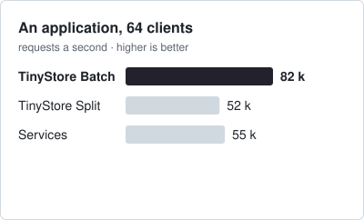
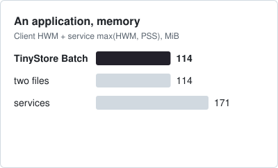
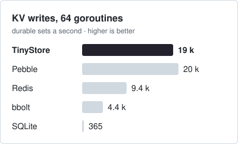
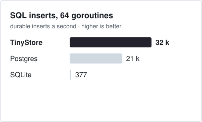
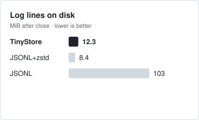
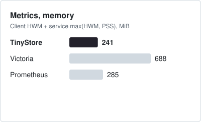
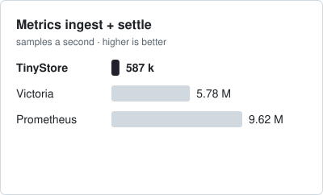
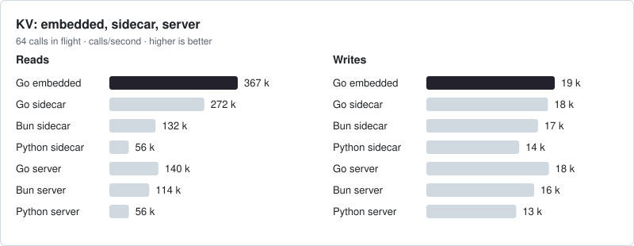

<!--
The headline, the pitch, the sample and the engines are the landing page's:
task readme writes them between the landing: markers from web/landing.md, and
the site's tests fail when the two differ. Change them there.
-->

<p align="center">
  <picture>
    <source media="(prefers-color-scheme: dark)" srcset=".github/assets/logo-dark.svg">
    
  </picture>
</p>

<h1 align="center">TinyStore</h1>

<!-- landing:headline -->

<p align="center">
  <b>A small storage runtime for applications.</b>
</p>

<p align="center">
  SQL, key-value state, durable jobs, files, search, logs and metrics in one directory, with one lifecycle, one memory budget and one backup.
</p>

<!-- /landing:headline -->

<p align="center">
  <a href="LICENSE"></a>
  
  
</p>

---

> **Release candidates first.** Releases begin with `v0.1.0-rc.N`, before
> `v0.1.0`. Until `v0.1.0`, the API may still change, and a file written by one
> release may not open in the next.

Go programs embed TinyStore as a library. Bun, Node and Python programs reach
the same directory through `tinystore serve`, a sidecar that their SDK starts,
and the same protocol serves remote clients.

It is not a new database engine and does not try to beat specialised ones at
their own job. SQLite is underneath, with formats of its own where a workload
needs one. The goal is to make the storage of an application on one machine
boring to operate.

## A first look

<!-- landing:sample -->

```ts
import { open } from '@tinyshed/tinystore'

await using store = await open('./data')

const db = await store.database('app', { migrations: './migrations' })
await db.exec`insert into users (id, name) values (${42}, ${'Ada'})`

const sessions = store.bucket<Session>('sessions', { idle: '30d' })
await sessions.set(digest(token), { userId: 42 })

const emails = store.queue<Email>('emails')
await emails.add({ to: 'ada@example.com' })

const avatars = store.files('avatars')
await avatars.put('42.png', Bun.file('avatar.png'))

store.logger('api').info('user created', { userId: 42 })
store.metrics.counter('signups_total').inc()
```

<details>
<summary><b>Python</b></summary>

```python
async with await tinystore.open("data") as store:
    db = await store.database("app", migrations="migrations")
    await db.exec("insert into users (id, name) values (?, ?)", 42, "Ada")

    sessions = store.bucket("sessions", Session, idle="30d")
    await sessions.set(digest(token), Session(user_id=42))

    emails = store.queue("emails", Email)
    await emails.add(Email(to="ada@example.com"))

    avatars = store.files("avatars")
    await avatars.put("42.png", Path("avatar.png").read_bytes())

    store.logger("api").info("user created", user_id=42)
    store.metrics.counter("signups_total").inc()
```

</details>

<details>
<summary><b>Go</b></summary>

```go
// errors left out
store, err := tinystore.Open(ctx, "data")
defer store.Close()

db, err := sqldb.Open(ctx, store, "app", sqldb.Migrations(os.DirFS("migrations")))
_, err = db.Exec(ctx, "insert into users (id, name) values (?, ?)", 42, "Ada")

sessions, err := kv.OpenBucket[Session](store, "sessions", kv.Idle(30*24*time.Hour))
err = sessions.Set(ctx, digest(token), Session{UserID: 42})

emails, err := jobs.OpenQueue[Email](store, "emails")
_, err = emails.Add(ctx, Email{To: "ada@example.com"})

avatars, err := blobs.OpenFiles(store, "avatars")
_, err = avatars.Put(ctx, "42.png", avatar)

slog.New(records.NewHandler(store, "api")).Info("user created", "userId", 42)
signups, err := metrics.OpenCounter(store, "signups_total")
signups.Inc()
```

</details>

<details>
<summary><b>Rust</b></summary>

```rust
let store = Store::open("data", Options::default())?;

let db = store.database("app").migrations("migrations").open()?;
db.exec(tinystore::sql!("insert into users (id, name) values (?, ?)", 42, "Ada"))?;

let sessions = store.bucket::<Session>("sessions").idle(Duration::from_hours(24 * 30)).open()?;
sessions.set(digest(&token), &Session { user_id: 42 })?;

let emails = store.queue::<Email>("emails").open()?;
emails.add(&Email { to: "ada@example.com".into() })?;

let avatars = store.files("avatars").open()?;
avatars.put("42.png", &avatar)?;

tracing::info!(user_id = 42, "user created"); // through store.logger("api").layer()
store.metrics()?.counter("signups_total").open()?.inc();
```

</details>

```sh
bun add @tinyshed/tinystore
pip install tinyshed-tinystore
go get tinyshed.org/tinystore
cargo add tinystore
```

<!-- /landing:sample -->

[Your first store](docs/start/first-store.md) builds a first program step by step.

## Engines

<!-- landing:engines -->

|                                           |                   |                                                                         |
|-------------------------------------------|-------------------|-------------------------------------------------------------------------|
| [SQL](docs/chat/messages.md)              | Relational state  | Your own SQLite databases: checked migrations, a query builder.         |
| [KV](docs/chat/sessions-and-limits.md)    | Application state | Values with expiry and versions; counters, rate limits, quotas, `once`. |
| [Jobs](docs/start/why.md#the-engines)     | Background work   | Work that runs at its time: retries, steps, schedules, limits.          |
| [Blobs](docs/start/why.md#the-engines)    | Files             | Files by path, written whole or not at all, checked when read.          |
| [Search](docs/start/why.md#the-engines)   | Words and vectors | Indexes of documents or of your tables, by words, by meaning, or both.  |
| [Channels](docs/start/why.md#the-engines) | Messages          | Messages to whoever listens now, sent from a transaction at its commit. |
| [Locks](docs/start/why.md#the-engines)    | Coordination      | Locks and semaphores with fences, across processes and connections.     |
| [Config](docs/start/why.md#the-engines)   | Settings          | Files and the environment in layers; secrets; settings changed live.    |
| [Records](docs/start/why.md#the-engines)  | Logs and events   | Read back by time, level, fields and text; followed as they arrive.     |
| [Metrics](docs/start/why.md#the-engines)  | Time series       | Samples kept bit for bit, answered exactly.                             |
| [Backup](docs/start/why.md#the-engines)   | The whole store   | One checked zip of every engine, taken while it runs.                   |

<!-- /landing:engines -->

By default each engine has its own file and its own writer. An application can
keep its jobs in its SQL database and commit a job together with its rows in
one commit, as [One directory, many engines](docs/start/directory.md#two-engines-in-one-file)
shows. One call backs up every engine into one checked zip.

## Documentation

The [documentation](docs/README.md) is a book that builds one application, an
AI chat, with each example in TypeScript, Python, Go and Rust. Start with these:

- [Why TinyStore](docs/start/why.md): what TinyStore is for and what it replaces
- [Your first store](docs/start/first-store.md): install it and write a first program
- [One directory, many engines](docs/start/directory.md): the files, and how each language reaches a store
- [The chat we build](docs/start/chat.md): the application the book builds

For reference, see the [API reference](docs/reference/api.md) and the
[wire protocol](docs/wire.md).

## Looking at a store

The same binary shows a person, and an AI agent, what a store holds while its
application runs. Both SDK packages install it as the `tinystore` command:
`bunx @tinyshed/tinystore …` and `uvx --from tinyshed-tinystore tinystore …` run it with
nothing else installed, and `go install
github.com/tinyshed/tinystore/cmd/tinystore@latest` builds it.

```sh
tinystore status ./data                            # each engine's bytes, and who serves the directory
tinystore logs ./data -f --level warn              # the application's logs, as they arrive
tinystore serve ./data                             # the directory's sidecar, until Ctrl+C
tinystore stop ./data                              # its server, once its work is finished
claude mcp add tinystore -- tinystore mcp ./data   # logs, kv, jobs and SQL for an agent, read only
```

[Your first store](docs/start/first-store.md#look-inside) shows the commands
at work. The image `ghcr.io/tinyshed/tinystore` serves a store to
remote clients, as [One directory, many engines](docs/start/directory.md#four-ways-to-open-a-store) shows.

## Numbers

**TinyStore does not beat every specialized database at its own workload.
It makes the combined workload of a small application cheap enough that
replacing several services does not mean giving up performance.**

The application workload at 64 concurrent clients completes **81,531
requests/s locally** and **43,178 requests/s on an 8-vCPU Yandex VM**, median
of three passes. With jobs joined to the application's SQL file and written
in one `Batch`, that is **1.49x and 1.52x** the Redis + PostgreSQL +
VictoriaMetrics + files stack. Every pass of this configuration has zero
errors, dropped logs and jobs left waiting.

Two three-minute passes on the VM complete 35,151 and 35,169 requests/s,
**1.35x the service stack**, and handle every queued job. This is a bounded
sustained-load check, not a half-hour steady-state guarantee.

**TinyStore Batch** stores the queue in the application's SQL database and
commits its rows and job together. **TinyStore Split** uses the default jobs
file and commits each file independently.

<p>
<picture><source media="(prefers-color-scheme: dark)" srcset=".github/assets/bench-stack-dark.svg"></picture>
<picture><source media="(prefers-color-scheme: dark)" srcset=".github/assets/bench-stack-memory-dark.svg"></picture>
<picture><source media="(prefers-color-scheme: dark)" srcset=".github/assets/bench-kv-dark.svg"></picture>
<picture><source media="(prefers-color-scheme: dark)" srcset=".github/assets/bench-sqldb-dark.svg"></picture>
<picture><source media="(prefers-color-scheme: dark)" srcset=".github/assets/bench-records-dark.svg"></picture>
<picture><source media="(prefers-color-scheme: dark)" srcset=".github/assets/bench-metrics-disk-dark.svg"></picture>
<picture><source media="(prefers-color-scheme: dark)" srcset=".github/assets/bench-metrics-memory-dark.svg"></picture>
<picture><source media="(prefers-color-scheme: dark)" srcset=".github/assets/bench-metrics-ingest-dark.svg"></picture>
</p>

The cards use local Linux-container medians on a Ryzen 7 7700, 16 visible
CPUs, Go 1.27.1 and Docker Desktop 29.6.2. Records: 445,136 private production
lines. Metrics: 5,090,400 TSBS samples, with ingest plus settle timed together.
Memory is client high-water RSS plus the greater of service high-water RSS
and final service-tree PSS, not a simultaneous whole-stack peak.
Application memory covers the full 8/64/256-client run.
In the application memory card, the upper solid bar is idle and the lower
faded bar is the load peak from the same process run. That card uses a separate
three-pass, three-second round with service idle memory explicitly measured.
Its TinyStore row uses the Batch configuration.

These full-comparison processes also link the comparison libraries. Small,
independently linked consumers on the Yandex VM start at **3.4 MiB** for the
empty probe, **3.7 MiB** for `tinystore.Open` alone, **8.5-9.3 MiB** for one
engine and **14.9 MiB** for all six engines, without a loaded corpus.

**Raw binary** is an actual uncompressed TSBS export: an eight-byte timestamp
and eight-byte float value per sample, plus a JSON index with the series'
labels, offsets and counts. Its **78.2 MiB** includes both files and has been
checked bit for bit. It is a plain representation, not a database with
queries, retention or integrity checks.

<details>
<summary><b>KV: embedded, sidecar and server benchmarks</b></summary>

<p>
<picture>
<source media="(prefers-color-scheme: dark) and (max-width: 600px)" srcset=".github/assets/bench-sdk-modes-mobile-dark.svg">
<source media="(max-width: 600px)" srcset=".github/assets/bench-sdk-modes-mobile-light.svg">
<source media="(prefers-color-scheme: dark)" srcset=".github/assets/bench-sdk-modes-dark.svg">

</picture>
</p>

Embedded means a direct Go library call. Bun and Python use their SDKs through
a local sidecar or a loopback TCP server with a token; they have no embedded
mode. Go sidecar/server rows isolate the process boundary within one language;
SDK rows also include that language's encoding and scheduling. All modes use
the same 100,000 keys and 128-byte values, in one interleaved session.

</details>

These are workload comparisons, not universal wins: cloud KV writes did
not improve, specialized KV engines read faster, and Batch at 256 clients
leaves a growing jobs queue. Metrics competitors do not have identical
commit durability. The cards measure `ad4f047`, before the exact block
summaries, which [a round of their own](https://github.com/tinyshed/research/blob/main/tinystore/reports/self-summary-2026-10-01.md)
measures. The saved revisions, all passes, limits and reproduction commands
are in the [round report](https://github.com/tinyshed/research/blob/main/tinystore/reports/runtime-continuation-2026-10-01.md).
The [consumer-memory and client-mode follow-up](https://github.com/tinyshed/research/blob/main/tinystore/reports/consumer-memory-2026-10-01.md)
records the small consumers, paired memory bars, raw representation and SDK modes.

The rounds, prototypes and open questions behind the design are in
[tinyshed/research](https://github.com/tinyshed/research/tree/main/tinystore).

## Origin

TinyStore started inside [Dashbin](https://github.com/tinyshed/dashbin), which
needed state, jobs, files and metrics without turning one self-hosted binary
into a set of services. Different workloads wanted different storage shapes,
but not different services, and the research grew into a project of its own.

## Development

TinyStore is developed with extensive AI assistance: its direction,
architecture and acceptance criteria are a person's, and coding agents do
much of the implementation, review and measurement. Generated code is not
evidence that anything works; the tests, fuzzers and reproducible
measurements are. [AGENTS.md](AGENTS.md) is the contract both follow.

## License

Apache-2.0.
