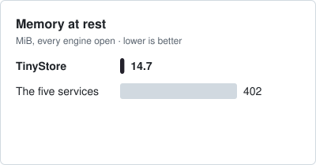
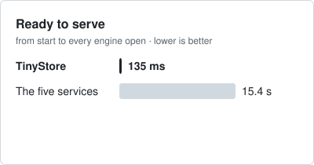
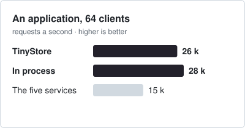
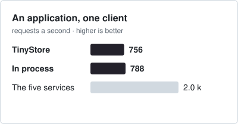
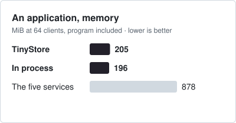
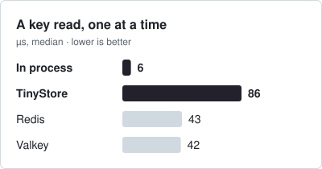
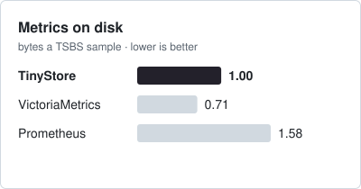
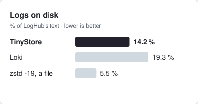

<!--
The headline, the pitch, the sample and the engines are the landing page's:
task readme writes them between the landing: markers from web/landing.md, and
the site's tests fail when the two differ. Change them there.
-->

<p align="center">
  <picture>
    <source media="(prefers-color-scheme: dark)" srcset=".github/assets/logo-dark.svg">
    
  </picture>
</p>

<h1 align="center">TinyStore</h1>

<!-- landing:headline -->

<p align="center">
  <b>A small storage runtime for applications.</b>
</p>

<p align="center">
  SQL, key-value state, durable jobs, files, search, logs and metrics in one directory, with one lifecycle, one memory budget and one backup.
</p>

<!-- /landing:headline -->

<p align="center">
  <a href="LICENSE"></a>
  
  
</p>

---

> **Version 0.3.** It is published to npm, PyPI, crates.io and GHCR. Until
> `1.0`, a minor release may still change the API, and
> [its notes](docs/releases/README.md) say what changed.

TinyStore is written in Rust. A Rust program compiles the core in, and the
program is the store. Bun, Node, Python and Go programs reach the same core
through their SDK: by default in a `tinystore` process the SDK starts beside
them, or inside their own process, and the same protocol serves remote
clients.

It is not a new database engine and does not try to beat specialised ones at
their own job. SQLite is underneath, with formats of its own where a workload
needs one. The goal is to make the storage of an application on one machine
boring to operate.

## A first look

<!-- landing:sample -->

```ts
import { open } from '@tinyshed/tinystore'

await using store = await open('./data')

const db = await store.database('app', { migrations: './migrations' })
await db.exec`insert into users (id, name) values (${42}, ${'Ada'})`

const sessions = store.bucket<Session>('sessions', { idle: '30d' })
await sessions.set(digest(token), { userId: 42 })

const emails = store.queue<Email>('emails')
await emails.add({ to: 'ada@example.com' })

const avatars = store.files('avatars')
await avatars.put('42.png', Bun.file('avatar.png'))

store.logger('api').info('user created', { userId: 42 })
store.metrics.counter('signups_total').inc()
```

<details>
<summary><b>Python</b></summary>

```python
async with await tinystore.open("data") as store:
    db = await store.database("app", migrations="migrations")
    await db.exec("insert into users (id, name) values (?, ?)", 42, "Ada")

    sessions = store.bucket("sessions", Session, idle="30d")
    await sessions.set(digest(token), Session(user_id=42))

    emails = store.queue("emails", Email)
    await emails.add(Email(to="ada@example.com"))

    avatars = store.files("avatars")
    await avatars.put("42.png", Path("avatar.png").read_bytes())

    store.logger("api").info("user created", user_id=42)
    store.metrics.counter("signups_total").inc()
```

</details>

<details>
<summary><b>Go</b></summary>

```go
// errors left out
store, err := tinystore.Open(ctx, "data")
defer store.Close()

db, err := sqldb.Open(ctx, store, "app", sqldb.Migrations(os.DirFS("migrations")))
_, err = db.Exec(ctx, "insert into users (id, name) values (?, ?)", 42, "Ada")

sessions, err := kv.OpenBucket[Session](store, "sessions", kv.Idle(30*24*time.Hour))
err = sessions.Set(ctx, digest(token), Session{UserID: 42})

emails, err := jobs.OpenQueue[Email](store, "emails")
_, err = emails.Add(ctx, Email{To: "ada@example.com"})

avatars, err := blobs.OpenFiles(store, "avatars")
_, err = avatars.Put(ctx, "42.png", avatar)

slog.New(records.NewHandler(store, "api")).Info("user created", "userId", 42)
signups, err := metrics.OpenCounter(store, "signups_total")
signups.Inc()
```

</details>

<details>
<summary><b>Rust</b></summary>

```rust
let store = Store::open("data", Options::default())?;

let db = store.database("app").migrations("migrations").open()?;
db.exec(tinystore::sql!("insert into users (id, name) values (?, ?)", 42, "Ada"))?;

let sessions = store.bucket::<Session>("sessions").idle(Duration::from_hours(24 * 30)).open()?;
sessions.set(digest(&token), &Session { user_id: 42 })?;

let emails = store.queue::<Email>("emails").open()?;
emails.add(&Email { to: "ada@example.com".into() })?;

let avatars = store.files("avatars").open()?;
avatars.put("42.png", &avatar)?;

tracing::info!(user_id = 42, "user created"); // through store.logger("api").layer()
store.metrics()?.counter("signups_total").open()?.inc();
```

</details>

```sh
bun add @tinyshed/tinystore
pip install tinyshed-tinystore
go get tinyshed.org/tinystore
cargo add tinystore
```

<!-- /landing:sample -->

[Your first store](docs/handbook/start/first-store.md) builds a first program step by step.

## Engines

<!-- landing:engines -->

|                                            |                   |                                                                         |
|--------------------------------------------|-------------------|-------------------------------------------------------------------------|
| [SQL](docs/guides/sql/README.md)           | Relational state  | Your own SQLite databases: checked migrations, a query builder.         |
| [KV](docs/guides/kv/README.md)             | Application state | Values with expiry and versions; counters, rate limits, quotas, `once`. |
| [Jobs](docs/guides/jobs/README.md)         | Background work   | Work that runs at its time: retries, steps, schedules, limits.          |
| [Blobs](docs/guides/blobs/README.md)       | Files             | Files by path, written whole or not at all, checked when read.          |
| [Search](docs/guides/search/README.md)     | Words and vectors | Indexes of documents or of your tables, by words, by meaning, or both.  |
| [Channels](docs/guides/channels/README.md) | Messages          | Messages to whoever listens now, sent from a transaction at its commit. |
| [Locks](docs/guides/locks/README.md)       | Coordination      | Locks and semaphores with fences, across processes and connections.     |
| [Config](docs/guides/config/README.md)     | Settings          | Files and the environment in layers; secrets; settings changed live.    |
| [Records](docs/guides/records/README.md)   | Logs and events   | Read back by time, level, fields and text; followed as they arrive.     |
| [Metrics](docs/guides/metrics/README.md)   | Time series       | Samples kept bit for bit, answered exactly.                             |
| [Backup](docs/guides/backup/README.md)     | The whole store   | One checked zip of every engine, taken while it runs.                   |

<!-- /landing:engines -->

By default each engine has its own file and its own writer. An application can
keep its jobs in its SQL database and commit a job together with its rows in
one commit, as [One directory, many engines](docs/handbook/start/directory.md#two-engines-in-one-file)
shows. One call backs up every engine into one checked zip.

## Documentation

The [documentation](docs/README.md) is a book that builds one application, an
AI chat, with each example in TypeScript, Python, Go and Rust. Start with these:

- [Why TinyStore](docs/handbook/start/why.md): what TinyStore is for and what it replaces
- [Your first store](docs/handbook/start/first-store.md): install it and write a first program
- [One directory, many engines](docs/handbook/start/directory.md): the files, and how each language reaches a store
- [The chat we build](docs/handbook/start/chat.md): the application the book builds

For reference, see the [API reference](docs/reference/api.md) and the
[wire protocol](docs/wire.md).

## Looking at a store

The same binary shows a person, and an AI agent, what a store holds while its
application runs. The npm and PyPI packages install it as the `tinystore`
command: `bunx @tinyshed/tinystore …` and `uvx --from tinyshed-tinystore tinystore …`
run it with nothing else installed, and each GitHub release carries it for
Linux, macOS and Windows.

```sh
tinystore status ./data                            # each engine's bytes, and who serves the directory
tinystore logs ./data -f --level warn              # the application's logs, as they arrive
tinystore serve ./data                             # the directory's sidecar, until Ctrl+C
tinystore stop ./data                              # its server, once its work is finished
claude mcp add tinystore -- tinystore mcp ./data   # logs, kv, jobs and SQL for an agent, read only
```

[Your first store](docs/handbook/start/first-store.md#look-inside) shows the commands
at work. The image `ghcr.io/tinyshed/tinystore` serves a store to
remote clients, as [One directory, many engines](docs/handbook/start/directory.md#four-ways-to-open-a-store) shows.

## Numbers

**TinyStore is not faster than each service at its own job. It replaces five
of them with one process, holds a fraction of their memory, and under load
an application on it answers more requests.**

<p>
<picture><source media="(prefers-color-scheme: dark)" srcset=".github/assets/bench-memory-dark.svg"></picture>
<picture><source media="(prefers-color-scheme: dark)" srcset=".github/assets/bench-ready-dark.svg"></picture>
<picture><source media="(prefers-color-scheme: dark)" srcset=".github/assets/bench-requests-dark.svg"></picture>
<picture><source media="(prefers-color-scheme: dark)" srcset=".github/assets/bench-requests-one-dark.svg"></picture>
<picture><source media="(prefers-color-scheme: dark)" srcset=".github/assets/bench-load-memory-dark.svg"></picture>
<picture><source media="(prefers-color-scheme: dark)" srcset=".github/assets/bench-kv-read-dark.svg"></picture>
<picture><source media="(prefers-color-scheme: dark)" srcset=".github/assets/bench-metrics-disk-dark.svg"></picture>
<picture><source media="(prefers-color-scheme: dark)" srcset=".github/assets/bench-logs-disk-dark.svg"></picture>
</p>

**TinyStore** is `tinystore serve`, the server `open()` starts beside a
program, with every engine open. **In process** is the same core loaded into
the program, `open(dir, { embedded: true })`. **The five services** are
PostgreSQL 18, Redis 8.10, MinIO, VictoriaMetrics 1.154 and Loki 3.7, each as
it ships. The application reads a session and a note, logs a line and counts
itself; one request in ten updates the note and queues a job, one in fifty
uploads 16 KiB. Every side kept every job and every log line, and a write
returns once it is on the disk.

Where TinyStore loses: with one to eight clients the services answer twice
the requests, because a request that writes syncs two files where
PostgreSQL syncs one. Writes that return before the sync stop at 30,000 a
second where Redis reaches 200,000. MinIO reads a 1 MiB file twice as fast,
VictoriaMetrics keeps a sample in 0.71 bytes against 1.00, and zstd keeps
LogHub's text in 5.5 % where TinyStore keeps 14.2 %.
[Benchmarks](docs/handbook/production/benchmarks.md) has every test and
these losses beside the wins.

v0.1.0 from npm and crates.io, medians of three passes in one Linux container
on a Ryzen 7 7700, programs in Bun 1.4.2 with Bun's own Redis, PostgreSQL and
S3 clients; memory and the start at rest are v0.4.0's, measured again there
on 27 October
([report](https://github.com/tinyshed/research/blob/main/tinystore/reports/at-rest-2026-10-27.md)). Metrics: TSBS DevOps, 26 million samples. Logs: 13 LogHub
datasets, 2.6 GiB. Method, every pass, the raw data and the commands are in
the [round's report](https://github.com/tinyshed/research/blob/main/tinystore/reports/release-2026-10-23.md).

## Origin

TinyStore started inside [Dashbin](https://github.com/tinyshed/dashbin), which
needed state, jobs, files and metrics without turning one self-hosted binary
into a set of services. Different workloads wanted different storage shapes,
but not different services, and the research grew into a project of its own.

## Development

TinyStore is developed with extensive AI assistance: its direction,
architecture and acceptance criteria are a person's, and coding agents do
much of the implementation, review and measurement. Generated code is not
evidence that anything works; the tests, fuzzers and reproducible
measurements are. [AGENTS.md](AGENTS.md) is the contract both follow.

## License

Apache-2.0.
