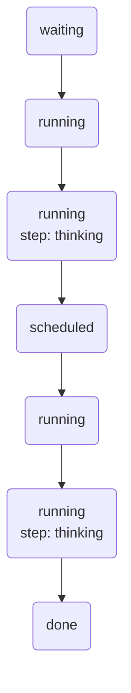

# Replies in the background

A model takes seconds to answer, and sometimes it fails. The chat cannot make
the user's request wait for it, so it saves the message, queues a job, and
answers at once. A worker writes the reply in the background and the browser
watches its progress. This chapter uses the Jobs engine, with the queue kept
inside the chat's SQL database so that a message and its job are saved
together.

## A place for the reply

A reply is a message that points at the message it answers. The next
migration adds that column, with a unique index, so that a message can have
one reply at most:

```sql title="migrations/0003_replies.sql"
alter table messages add column reply_to integer references messages (id);
create unique index messages_reply_to on messages (reply_to);
```

## Open the queue

```ts
interface Reply {
	messageId: number
}

const db = await store.database('chat', { migrations: `${import.meta.dirname}/migrations` })
const replies = db.queue<Reply>('replies', {
	attempts: 5,
	backoff: { initial: '5s', max: '10m' },
	concurrency: 4,
})
```

```python
@dataclass
class Reply:
    message_id: int


db = await store.database("chat", migrations=Path(__file__).parent / "migrations")
replies = db.queue(
    "replies", Reply,
    attempts=5,
    backoff=tinystore.Backoff(initial="5s", max="10m"),
    concurrency=4,
)
```

```go
type Reply struct {
	MessageID int64 `json:"messageId"`
}

db, err := sqldb.Open(ctx, store, "chat", sqldb.Migrations(os.DirFS("migrations")))
replies, err := jobs.OpenQueue[Reply](db, "replies",
	jobs.Attempts(5),
	jobs.Backoff{Initial: 5 * time.Second, Max: 10 * time.Minute},
	jobs.Concurrency{Total: 4})
```

```rust
#[derive(Serialize, Deserialize, Clone)]
struct Reply {
    message_id: i64,
}

let db = store.database("chat").migrations("migrations").open()?;
let replies = db
    .queue::<Reply>("replies")
    .attempts(5)
    .backoff(Duration::from_secs(5), Duration::from_mins(10))
    .concurrency(Concurrency::total(4))
    .open()?;
```

The queue opens from `db`, not from `store`, so its jobs live in
`sql/chat.db` next to the messages. A job's value is JSON, so a worker in
another language can read it.

| Option        | Here          | What it does                                                     |
|---------------|---------------|------------------------------------------------------------------|
| `attempts`    | 5             | runs a job gets before it fails for good, the first one included |
| `backoff`     | 5 s to 10 min | the wait before a retry, doubling each time, a little random     |
| `concurrency` | 4             | replies written at once, across every worker of every process    |
| `timeout`     | 1 min         | how long one run may take before it is told to stop              |

## Save a message and its job together

```ts
const messageId = await db.tx(async tx => {
	const message = await tx.exec`insert into messages (chat_id, role, text, created_at)
		values (${chatId}, 'user', ${text}, ${Date.now()})`
	const id = message.lastInsertRowid
	await tx.with(replies).add({ messageId: id }, { id: `reply:${id}` })
	return id
})
```

```python
async def accept(tx: tinystore.SqlTx) -> int:
    message = await tx.exec(
        "insert into messages (chat_id, role, text, created_at) values (?, 'user', ?, ?)",
        chat_id, text, time.time_ns() // 1_000_000,
    )
    id = message.last_insert_rowid
    await tx.with_(replies).add(Reply(message_id=id), id=f"reply:{id}")
    return id


message_id = await db.tx(accept)
```

```go
var messageID int64
err = db.Tx(ctx, func(tx *sqldb.Tx) error {
	message, err := tx.Exec(ctx, `insert into messages (chat_id, role, text, created_at) values (?, 'user', ?, ?)`,
		chatID, text, time.Now().UnixMilli())
	if err != nil {
		return err
	}
	messageID = message.LastInsertRowid
	_, err = replies.In(tx).Add(ctx, Reply{MessageID: messageID}, jobs.ID(fmt.Sprint("reply:", messageID)))
	return err
})
```

```rust
let message_id = db.tx(|tx| -> tinystore::Result<i64> {
    let message = tx.exec(sql!(
        "insert into messages (chat_id, role, text, created_at) values (?, 'user', ?, ?)",
        chat_id,
        text,
        unix_millis(SystemTime::now())
    ))?;
    let id = message.last_insert_rowid;
    tx.with(&replies).id(format!("reply:{id}")).add(&Reply { message_id: id })?;
    Ok(id)
})?;
```

`tx.with(replies)` (`with_` in Python, `replies.In(tx)` in Go) takes the
queue into the transaction. The message and its job commit together, or
neither does (contract JOB-02). There is no moment when a message exists and
nobody will ever answer it, and no moment when a worker looks for a message
that is not saved yet.

The job's id, `reply:41`, names it, so that the browser can watch it and a
second `add` with the same id adds nothing.

## Write the reply

```ts
const worker = replies.work(async ({ messageId }, run) => {
	const message = await db.one<Message>`select * from messages where id = ${messageId}`
	if (message === undefined) return run.fail('the message was deleted')

	const history = await run.step('history', () =>
		db.all<Line>`select role, text from messages where chat_id = ${message.chat_id} order by id desc limit 20`)
	run.setProgress({ step: 'thinking' })
	const answer = await run.step('answer', () => model.answer(history))

	await db.exec`insert into messages (chat_id, role, text, created_at, reply_to)
		values (${message.chat_id}, 'assistant', ${answer}, ${Date.now()}, ${message.id})
		on conflict (reply_to) do nothing`
})

await worker.stop() // at shutdown
```

```python
async def write_reply(reply: Reply, run: tinystore.Run) -> tinystore.Outcome | None:
    message = await db.one(Message, "select * from messages where id = ?", reply.message_id)
    if message is None:
        return run.fail("the message was deleted")

    history = await run.step(
        "history",
        lambda: db.all(Line, "select role, text from messages where chat_id = ? order by id desc limit 20", message.chat_id),
    )
    run.set_progress({"step": "thinking"})
    answer = await run.step("answer", lambda: model.answer(history))

    await db.exec(
        """insert into messages (chat_id, role, text, created_at, reply_to) values (?, 'assistant', ?, ?, ?)
        on conflict (reply_to) do nothing""",
        message.chat_id, answer, time.time_ns() // 1_000_000, message.id,
    )
    return None


worker = replies.work(write_reply)
await worker.stop()  # at shutdown
```

```go
err = replies.Work(ctx, func(ctx context.Context, reply Reply, run *jobs.Run) error {
	message, found, err := sqldb.One[Message](ctx, db, `select * from messages where id = ?`, reply.MessageID)
	if err != nil {
		return err
	}
	if !found {
		return run.Fail("the message was deleted")
	}
	history, err := jobs.Step(ctx, run, "history", func(ctx context.Context) ([]Line, error) {
		return sqldb.All[Line](ctx, db, `select role, text from messages where chat_id = ? order by id desc limit 20`, message.ChatID)
	})
	if err != nil {
		return err
	}
	run.SetProgress(map[string]string{"step": "thinking"})
	answer, err := jobs.Step(ctx, run, "answer", func(ctx context.Context) (string, error) {
		return model.Answer(ctx, history)
	})
	if err != nil {
		return err
	}
	_, err = db.Exec(ctx, `insert into messages (chat_id, role, text, created_at, reply_to) values (?, 'assistant', ?, ?, ?)
		on conflict (reply_to) do nothing`, message.ChatID, answer, time.Now().UnixMilli(), message.ID)
	return err
}) // runs until ctx ends, then waits for the replies under way
```

```rust
let reader = db.clone();
let worker = replies.work(move |reply: Reply, run| -> Result<(), AppError> {
    let Some(message) = reader.one::<Message>(sql!("select * from messages where id = ?", reply.message_id))? else {
        return Ok(()); // the message was deleted
    };
    let history: Vec<Line> = run.step("history", || {
        reader.all(sql!("select role, text from messages where chat_id = ? order by id desc limit 20", message.chat_id))
    })?;
    run.set_progress(&json!({ "step": "thinking" }))?;
    let answer: String = run.step("answer", || model.answer(&history))?;
    reader.exec(sql!(
        "insert into messages (chat_id, role, text, created_at, reply_to) values (?, 'assistant', ?, ?, ?)
         on conflict (reply_to) do nothing",
        message.chat_id,
        answer,
        unix_millis(SystemTime::now()),
        message.id
    ))?;
    Ok(())
})?;

worker.stop(); // at shutdown
```

The handler gets the job's value and its run. If it returns, the job is
done. If it throws, the job runs again after the backoff, and fails for good
after 5 attempts. It can also answer with `run.fail`, `run.retry` or
`run.snooze`, as [Retry, snooze and
fail](../../guides/jobs/steps.md#retry-snooze-and-fail) shows. `snooze` is
for the model's own rate limit: when the API answers "slow down, try in 30
seconds", that is no failure, and it must not use up an attempt. `fail` is
for a job that can never succeed, such as a message deleted before its reply
was written.

## What a crash does

`run.step(name, fn)` runs `fn` once and keeps its answer across the job's
attempts. If the worker dies after the model answered, the next attempt gets
the kept answer back instead of asking the model again, and runs only what is
left:

```scene
code ts
  replies.work(async ({ messageId }, run) => {
    const history = await run.step('history', () => loadHistory(messageId))
    const answer = await run.step('answer', () => model.answer(history))
    await db.exec`insert into messages … on conflict (reply_to) do nothing`
  })
end
actor worker "Worker"   at 10,30 icon=cpu
actor again  "Restarted" at 10,78 icon=cpu
actor db     "chat.db"  at 50,50 icon=database
actor model  "Model API" at 90,50 icon=cloud
link worker db
link worker model
set db "steps: none"
set model "calls: 0"

step "The worker loads the chat's history. run.step keeps it in chat.db under the job." line=2
  send worker -> db "history"
  set db "steps: history"

step "It asks the model, which takes eight seconds and costs money. The answer is kept as the step answer." line=3
  send worker -> model "prompt"
  set model "calls: 1"
  send model -> worker "answer"
  send worker -> db "keep answer"
  add db "answer"

step "A deploy kills the process before the reply is inserted. Its lease on the job ends: at once when the store opens again, or within 30 seconds if only the worker died." line=4
  mark worker down
  cut worker db
  cut worker model

step "The next attempt gets both steps back from chat.db. It does not call the model again." line=2-3
  link again db
  send again -> db "run reply:41"
  send db -> again "history, answer" color=ok
  say model "still 1 call"

step "It inserts the reply. on conflict do nothing keeps one reply, even if the first run had inserted it." line=4
  send again -> db "insert reply" color=ok
  set db "reply: saved"
```

A run that ends before it is marked done runs again (contract JOB-05), and
the steps it finished are not run again (contract JOB-06). So only what is
left must bear running twice: here the insert says `on conflict (reply_to) do
nothing`, so the reply is saved once whatever happens.

## Show the reply's progress

The browser shows "3 ahead", then "thinking", then the reply. It watches the
job by its id:

```ts
for await (const job of replies.watch(`reply:${messageId}`)) {
	events.send({ state: job.state, ahead: job.ahead, progress: job.progress })
}
```

```python
async for job in replies.watch(f"reply:{message_id}"):
    await events.send({"state": job.state, "ahead": job.ahead, "progress": job.progress})
```

```go
for job, err := range replies.Watch(ctx, fmt.Sprint("reply:", messageID)) {
	if err != nil {
		return err
	}
	events.Send(job.State, job.Ahead, job.Progress)
}
```

```rust
for job in replies.watch(format!("reply:{message_id}")) {
    let job = job?;
    events.send(job.state, job.ahead, job.progress);
}
```

`watch` yields the job as it is, then again each time it changes, and ends
when the job ends ([How a watch
behaves](../../guides/jobs/watching.md#how-a-watch-behaves)). A reply that
failed once and succeeded on its second attempt looks like this:



`ahead` counts the jobs that run before a waiting one. Stream these to the
browser over server-sent events, and the chat needs no status table: the
queue knows where every reply is.

## Why this design?

**Why the queue lives in the chat's database.** A message and its job in two
files can part in a crash, which systems built on a queue server patch with
an outbox table and a relay. A queue opened from `db` commits with the
messages instead: see [Two engines in one
file](../start/directory.md#two-engines-in-one-file).

**Why steps.** A retry that starts from the top asks the model again: more
cost, more time and maybe a different answer. A step keeps its answer in the
database under the job, so a retry continues where the last attempt stopped.
Steps end with their job, so they never pile up.

**Why `concurrency` counts every process.** The chat may run four web
processes, each with a worker. If each one allowed four replies at once, the
model would get sixteen requests. `concurrency: 4` is a limit of the queue,
across every worker of the store, so the model sees four at most.

**Why progress lives in memory.** Nobody needs progress after a restart, so
`setProgress` writes nothing to the disk, and a worker can call it as often
as it likes ([How a watch
behaves](../../guides/jobs/watching.md#how-a-watch-behaves)).

**Why at least once, and why an attempt counts before it runs.** A worker
can die after the model answered and before the job was marked done, and no
queue can know whether the effect happened, so TinyStore runs the job again
rather than risk never running it. [How a job
lives](../inside/how-a-job-lives.md#what-a-crash-does) gives both reasons.

## See also

- [Messages](messages.md): the database and the transaction this chapter
  builds on.
- [Your first store](../start/first-store.md#what-a-crash-does): a job that
  survives a crash before any worker runs it.
- [Limits and defaults](../production/limits.md#jobs): every bound of Jobs,
  from `attempts` and `backoff` to the size of a job's value.
- [Jobs API reference](../../reference/bun/jobs.md): every call of queues,
  workers and runs.
