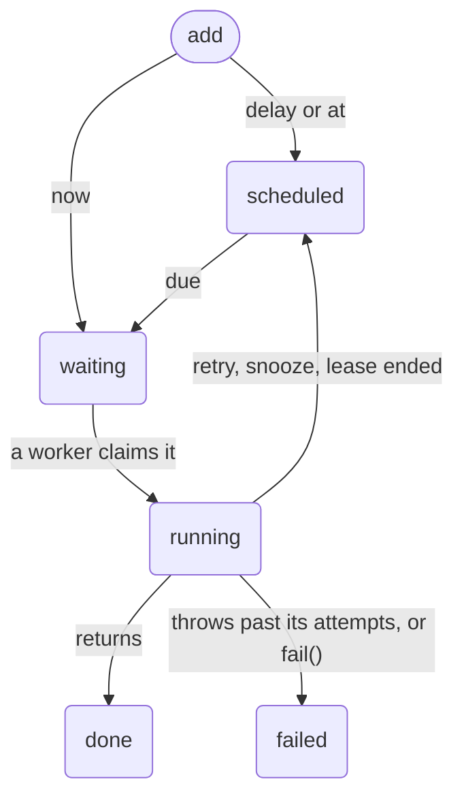

# How a job lives

A job is a row in a SQLite file that moves through a few states until it is
done or fails for good. This chapter draws those states, shows what a worker
holds while it runs a job, and goes through what a crash does at each
moment. It is the mechanism behind [Replies in the
background](../chat/replies.md).

## The states



| State       | The job                                                                   |
|-------------|---------------------------------------------------------------------------|
| `scheduled` | waits for its time                                                        |
| `waiting`   | is due, and waits for a worker; `ahead` counts the jobs before it         |
| `running`   | a worker holds a lease on it                                              |
| `done`      | finished; kept while `dedupe` says, so that its id adds nothing           |
| `failed`    | failed for good; kept with its error while `keep` says, 7 days unless set |

Jobs that are due start in the order of their time (contract JOB-01). A job
cancelled while it waits is gone; `watch` shows it as `cancelled`, a state
only a watcher sees.

## A lease

A worker claims due jobs in batches, and takes a lease on each: a row that
says "this worker holds this job until this time". A lease lasts 30 seconds,
and the worker renews it every 15 seconds while the handler runs. So a lease
does not bound how long a handler may take, which is the queue's `timeout`;
it bounds how long a vanished worker keeps a job.

A lease is its attempt. When the handler answers, the worker settles the job
by naming the attempt it claimed. If the lease ran out meanwhile and another
worker took the job, the late settlement changes nothing (contract JOB-05).

## What a crash does

```scene
code ts
  replies.work(async ({ messageId }, run) => {
    const answer = await run.step('answer', () => model.answer(messageId))
    await db.exec`insert into messages … on conflict (reply_to) do nothing`
  })
end
actor w1   "Worker 1"  at 10,25 icon=cpu
actor w2   "Worker 2"  at 10,75 icon=cpu
actor jobs "chat.db"   at 55,50 icon=database
actor llm  "Model API" at 92,50 icon=cloud
link w1 jobs
link w2 jobs
link w1 llm
set jobs "reply:41 waiting"

step "Worker 1 claims reply:41 and takes a 30-second lease. The attempt is counted now, before the handler runs." line=1
  send w1 -> jobs "claim"
  set jobs "reply:41 running, attempt 1"

step "The handler asks the model. The step's answer is kept under the job." line=2
  send w1 -> llm "prompt"
  send llm -> w1 "answer"
  send w1 -> jobs "keep step answer"
  add jobs "step: answer"

step "Worker 1 dies. Nothing renews its lease, so it runs out." line=3
  mark w1 down
  cut w1 jobs
  cut w1 llm
  say jobs "lease ended"

step "Worker 2 claims the job for attempt 2. Its step returns the kept answer, and the insert runs once." line=2-3
  send w2 -> jobs "claim"
  set jobs "reply:41 running, attempt 2"
  send jobs -> w2 "step: answer" color=ok
  send w2 -> jobs "insert reply" color=ok
  set jobs "reply:41 done"
```

At each moment, a crash leaves the job in a state the next worker can take
over:

| The crash comes                       | What happens next                                                                         |
|---------------------------------------|-------------------------------------------------------------------------------------------|
| before `add` returned                 | nothing was promised: the job may or may not exist, and `get` says which                  |
| after `add`, before any worker        | the job waits on the disk and runs when a worker comes (contract DUR-01)                  |
| while the handler runs, before a step | the lease ends; the job runs again from the top, as the next attempt                      |
| after a step was kept                 | the next attempt gets the step's answer back and runs only what is left (contract JOB-06) |
| after the handler, before settling    | the job runs again: a job runs at least once, not exactly once                            |
| the whole store's process dies        | the next open ends every lease that process held, at once                                 |

Every attempt is counted when it is claimed, before the handler runs. A job
whose handler crashes the process every time still reaches its `attempts`
and fails for good, instead of taking the worker down on every restart. A
job that repeats moves on to its next time instead, its error kept.

## Retries and their waits

A handler that throws runs again after its backoff: one second, then two,
four, and so on, up to an hour, each a tenth longer or shorter at random so
that a thousand failed jobs do not retry in the same instant. A handler can
answer instead of throwing:

| The handler returns | The job                                          |
|---------------------|--------------------------------------------------|
| `run.retry('10m')`  | runs again in ten minutes, counted as an attempt |
| `run.snooze('10m')` | runs again in ten minutes, not counted           |
| `run.fail(reason)`  | fails for good now, with the reason as its error |

## Limits across processes

`concurrency` and `rate` are the queue's, not a worker's. A claim counts the
live leases of the queue, and of a group, in the same transaction that takes
new ones, so two workers in two processes never both take the last place. A
job of a full group is set aside, not skipped forever: it is claimed as soon
as its group has room.

## Why this design?

**Why jobs live in SQLite and not in a queue server.** A job that lives in
the same file as the rows it is about commits with them (contract JOB-02).
A queue server can never do that, which is why systems built on one need an
outbox table and a relay. And a job in a file survives every restart that the
file survives.

**Why leases instead of locks.** A lock held by a dead worker is held forever,
unless something watches the worker. A lease ends by itself. The only cost is
that a job may run twice, which is true of every queue that does not lose
jobs, so steps and unique keys make the second run harmless.

**Why at least once.** A worker can always die after the work and before the
settlement. No queue can know whether the email went out, so it must choose
between running the job again and possibly never running it. TinyStore never
loses a job, and tells you so.

## See also

- [Replies in the background](../chat/replies.md): a queue, a worker, steps
  and a watch from the program's side.
- [The journey of a write](journey-of-a-write.md): how a claim and a
  settlement reach the disk.
