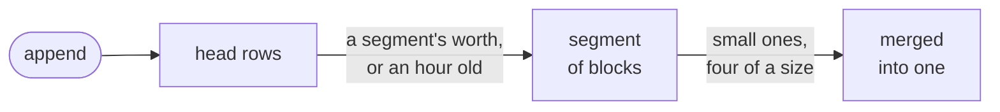
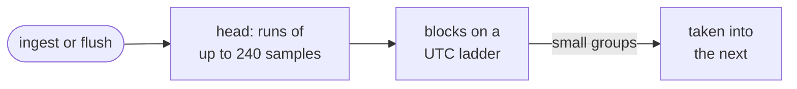

# How logs and metrics pack

A busy program writes millions of log lines and metric samples a day. Kept as
one row each, they would make `records.db` and `metrics.db` huge and every
query slow. This chapter explains how both engines pack what they receive
into compact blocks, still stored as rows of SQLite, and how a query skips
the blocks that cannot match.

## Logs and events: from rows to blocks

An event is written first as a row of the stream's head, so that `append`
returns quickly and a read finds it at once. Once a stream has a segment's
worth of events, or its oldest waiting event is an hour old (half the
stream's `keep` when that is shorter), the engine packs them into a segment:
blocks of events sorted by their time. Events that
arrive more than ten seconds late are packed apart, so they never force a
packed segment to be rewritten. Small segments are later merged, four of a
size at a time, keeping the places where each one began.

Each block also keeps the order in which its events arrived: the head row
each event was written in, and its place in that row. A read orders events
that share a time by it, so they come back in the order they were appended,
across streams, late events and merges, as [Events with the same
time](../../guides/records/reading.md#events-with-the-same-time) shows.

Inside a block, events are stored by column: one column per key of `fields`
and `context`, plus the time, the arrival, the level, the name and the message. Each
column picks the smallest encoding that gives its values back exactly:

| A column of          | Is kept as                                                        |
|----------------------|-------------------------------------------------------------------|
| times                | the steps between them, or one steady step, in as few bits as fit |
| arrivals             | the first, then the steps between them, the most common one once  |
| integers             | their steps, a dictionary, or the one value most rows share       |
| repeated text        | a dictionary of the values and a small index per event            |
| other text           | zstd, with the timestamps it spells cut out and kept as numbers   |
| UUIDs and hex        | their bytes, not their 36 characters                              |
| times inside a value | how far behind the event's own time they lie                      |

A value comes back as it was written, byte for byte: `1.2300`, `-0` and the
order of a JSON object's keys included.

## Reading only what can match

A query never reads every event. Beside each block, the segment keeps what
rules the block out:

- the block's first and last time, so a range skips the others;
- bloom filters of its trace ids and of values that rarely repeat, such as a
  request id, so `traceId` and `where: { requestId }` open only blocks that
  may hold them;
- the names of the keys its events hold, so `fieldNames` answers without
  opening a block.

A block that passes is opened, and only the columns the query asked about are
decoded. `search` reads every event that the other conditions leave, since a
phrase can be anywhere.

## Metrics: runs of samples

A series' samples arrive in a head of short runs, up to 240 samples each, and
a write rewrites only the run it reaches. Runs are packed into blocks where
the units of a UTC ladder begin, so that a block never crosses an hour or a
day boundary that an aggregate might ask about. A block holds at most 240
samples.

Each block keeps its samples' times and values with the shortest encoding
that gives every value back bit for bit:

| What      | Encodings tried                                                                                             |
|-----------|-------------------------------------------------------------------------------------------------------------|
| times     | evenly apart as one step, or the changes between steps; series written together share one clock             |
| values    | constant; integers in Simple8b words; a decimal grid and how far each value lies off it; Gorilla's XOR; raw |
| the block | zstd on top, when it is shorter                                                                             |

Every encoding proves that the original bits come back, value by value, or
the block takes another. `-0`, NaN payloads and infinities are values, not
edge cases.

Each block also keeps an exact summary of its samples, such as their count,
sum, smallest and largest. An aggregate whose bucket covers a whole block answers from
the summary without decoding a sample, and decodes only the blocks that a
bucket's edge cuts.

## The rules that keep answers exact

- **A counter's increase is computed from the raw samples**, sorted by time:
  on `100 → 110 → 5 → 20` the increase is 30, and the 30 needs the value it
  reset from.
- **A sealed frontier never moves back.** Packing seals a prefix of a series,
  up to a watermark that trails its newest sample. A sample behind the
  watermark is refused and counted, never allowed to reopen a block.
- **Retention clips a read before a summary is used**, so a block that is
  half expired is decoded, not answered from a summary that still counts the
  expired half.
- **A query is bounded before it starts**: decoded samples, bytes, blocks and
  series each have a budget, and passing one is a `limit` error, never a
  quietly smaller answer.

## Why this design?

**Why blocks in SQLite rather than files of their own.** A block is a row, so
packing a segment and deleting the head rows it replaced is one transaction.
A crash in the middle of packing leaves the last commit, and the next packing
starts from it (contract DUR-09). The engines get compression and skipping
from their own layout, and crash safety and backups from SQLite.

**Why column by column.** Log lines and samples repeat themselves: the same
keys, the same levels, the same routes, timestamps a second apart. Stored by
column, each kind of repetition finds the encoding that removes it, and a
query reads only the columns it needs.

**Why bit for bit.** Whoever draws a chart can round. Nobody can unround. A
metrics store that rounds as it stores answers a question you did not ask,
and you cannot tell.

**Why the encodings were chosen by measurement.** Each one was kept because a
research round measured it on real logs and real metrics against the
alternatives, file size and query time both. The Go engine's FSE coder was
left out by the owner's choice, after it saved 0.15 bytes per event. The
[research reports](https://github.com/tinyshed/research/tree/main/tinystore/reports)
have every number with its machine and data.

## See also

- [What it is doing](../chat/what-it-is-doing.md): writing and reading logs
  and events.
- [How fast it is](../chat/how-fast-it-is.md): instruments and aggregates.
