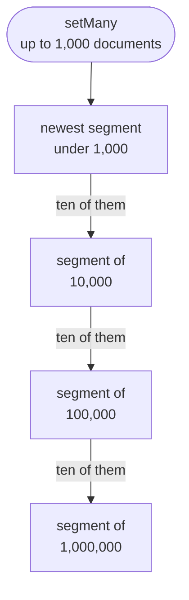

# How search finds

A search for "lisbon" over a million messages returns the best ten in
milliseconds, and the same ten every time. A search by a vector finds the
nearest meanings, exactly by default. This chapter explains what an index
keeps, how a search by words skips most of it without losing the exact best,
and how vectors are searched exactly or from clusters.

## From text to words

Every field's text goes through the steps of [Words in any
language](../../guides/search/fields.md#words-in-any-language) when a
document is set and when a search is asked. Besides Latin accents, the first
step also removes Russian stress marks. A Cyrillic word's stem is the one
that Snowball's Russian stemmer gives.

## Postings in blocks

For each word, the index keeps its postings: the documents that hold it,
with how often and in which field. A word in at most 16 documents keeps them
in one row. A common word's postings are cut into blocks of 128 documents,
and a directory per word records, for each block, the highest score that any
document in it could reach.

```text
"lisbon"   block 1: docs 3…912      best possible 7.1
           block 2: docs 915…2,040  best possible 9.4
           block 3: docs 2,051…3,890 best possible 2.2
```

Each block stores the gaps between its documents and their frequencies in as
few bits as its largest needs, and a word's blocks lie one after another in
rows of about 32 KiB. The directory has a fixed width, so a search reads it
without decoding, and it reads a block at its place in its row without
running a query for it. An index of MS MARCO's 8.8 million passages takes
1.9 bytes per posting in its pages, as the
[search-tinystore](https://github.com/tinyshed/research/blob/main/tinystore/reports/search-tinystore-2026-11-02.md) research round
measured it.

The postings live in segments, as in Lucene and SQLite's FTS5. A segment
holds every word's postings for a run of documents, all next to each other
in the file, and a search reads a word's piece in each segment as one list.
Writes go to the newest segment, so a batch of documents writes about as
many pages as its postings fill, however many words it has.

## Exact, and still fast

A search by words scores documents with BM25, which weighs a word by how rare
it is and how often a document uses it, against the field's weight. It reads
the documents in windows of 4,096, and for each window adds up the best
possible scores of the blocks the search's words have there. A window whose
best possible total cannot beat the tenth best score found so far is skipped
without reading a posting.

Inside a window, the words whose blocks can't lift a document past the tenth
best on their own are passive. The other words add up their postings, and a
passive word is read only for the documents they found, the word that can
add most first, and only while it can still change the result. A document
length is read only for a posting that is scored, and most postings never
are.

The answer is the same as scoring every document (contract SRCH-01). Scores
are kept in whole points, so merging or cleaning up the index never changes a
score or the order of a tie.

On MS MARCO's 8.8 million passages, one query at a time, a search took
3.3–3.5 ms at the median and 21–23 ms at the 99th percentile. Tantivy took
2.3–2.5 ms and 27–30 ms in the same run, and Lucene 1.7–1.9 ms and 12–13 ms.
The run used 1,097 of MS MARCO's queries, warm, on a Ryzen 7 7700 in a WSL2
container with 2 CPUs, and the
[report](https://github.com/tinyshed/research/blob/main/tinystore/reports/search-tinystore-queries-2026-11-02.md) has every number.

## New documents and old ones

A document set is visible to the next search at once (contract SRCH-04),
because a set writes its postings into the newest segment, which searches
read like any other. The newest segment takes documents until it holds a
thousand; then the next set starts another. Background work merges ten
segments of a size into one of the next size, a few thousand words per
commit:



So a posting is written again only once per size, and a search reads a
handful of segments. An index of MS MARCO that background work left in 22
segments answered at the median in 1.03 to 1.13 times the time of the same
index merged into one, in the [report](https://github.com/tinyshed/research/blob/main/tinystore/reports/search-tinystore-queries-2026-11-02.md)
above. A deleted document is marked gone. Merges leave it out, and once the
gone documents pass half a percent of the index, they are purged from the
rest.

A misspelt word that matches nothing is read as the nearest word the index
holds, by the rules of [Typos](../../guides/search/typos.md#the-rules). The
words the index holds are kept in a finite-state dictionary, which finds the
nearest ones without reading every word.

## Vectors, exactly

Each vector is stored as it was given, as 32-bit floats, and beside it as a
code: one byte per dimension of its direction. A search by a vector reads
every code, and from the byte products it computes a bound on each cosine.
Only the vectors that the bound cannot rule out of the best ten are scored
again on their real floats. The answer is the exact best by cosine, scores
bit for bit (contract SRCH-02).

## Vectors, from clusters

For millions of vectors, an index opened with `recall: 0.95` groups them into
about √n clusters by spherical k-means, once it holds 2,048 vectors. Each
member keeps one bit per dimension, as the RaBitQ method does. A search reads
the clusters nearest the question, estimates the cosine of their members from
the bits, and scores again on the floats those most likely to win.

How many clusters a search reads and how many members it scores again is
measured on a sample of the index's own vectors, and measured again as the
index grows. The promise is the average share of the exact best ten that a
search finds, never a fixed number of clusters, because the same share of
clusters found 0.94 of the exact ten on a million MIRACL passages and 0.90
on Amazon's products and StackExchange, in the
[search-hybrid](https://github.com/tinyshed/research/blob/main/tinystore/reports/search-hybrid-2026-10-16.md)
round, on a Ryzen 7 7700 in a WSL2 container with 2 CPUs. Every score a
search returns is still its vector's exact cosine.

| Search              | Reads                                           | Answers                               |
|---------------------|-------------------------------------------------|---------------------------------------|
| by vector, exact    | every vector's one-byte code, then a few floats | the exact best ten                    |
| by vector, `recall` | the nearest clusters' bits, then a few floats   | `recall` of the exact best on average |
| by words            | the blocks that can still win                   | the exact best ten                    |

## Filters

A filter field's values are kept as keys beside the words, and a number at
eight precisions, so a range is a handful of keys. A search with a filter
keeps to the documents it passes before ranking (contract SRCH-03). When they
are few, they are scored alone; when they are many, they are crossed out of
each window or of the vector scan.

## Why this design?

**Why exact by default.** An approximate index answers differently as it
grows, and a user who searched "lisbon" yesterday and today gets two
different lists for the same messages. Exact answers are reproducible, and
block-max skipping makes them fast enough for the sizes one machine holds.
`recall` is there for the sizes where exact is too slow, and you ask for it.

**Why clusters and not HNSW.** HNSW, the graph most vector databases use,
answers faster, but it keeps every vector's neighbours in memory and its
index costs many times the vectors themselves. On a million passages with
bge-m3's vectors of 1,024 dimensions, clusters answered in about 3 ms at
0.94 of the exact ten holding 96 MiB, against HNSW's 0.4 ms and 2.2 GiB, in
the [search-vectors](https://github.com/tinyshed/research/blob/main/tinystore/reports/search-vectors-2026-10-16.md)
round, on a Ryzen 7 7700 in a WSL2 container with 2 CPUs. For an embedded
store sharing a machine with its program, the memory decides.

**Why one index for words and vectors.** A hybrid search in two systems needs
two queries, two sets of scores and code to merge them. In one index, both
halves read the same documents in one snapshot, the filter applies to both,
and the scores are scaled and added in one place.

The [research reports](https://github.com/tinyshed/research/tree/main/tinystore/reports)
hold the measurements, with their machines and collections.

## See also

- [Finding old messages](../chat/finding-old-messages.md): an index of a
  table, typos, vectors and filters from the program's side.
