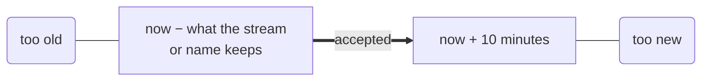

# Time and errors

Two things every engine shares: the clock it reads and the errors it returns.
A key expires, a job comes due and a log line is stamped by one clock, which a
test can move. A failure is one of a small set of kinds, the same in every
engine and every language, and its message names exactly what failed.

## One clock

Every engine reads the time from the store's clock, once per call. Expiry of
keys and files, a job's due time, a quota's windows, a log line's time and a
metric's sample all agree on what "now" is.

A test gives the store a clock it moves by hand, as [Keeping
it](../chat/keeping-it.md#test-on-a-clock-you-move) shows. That clock never
moves backwards: engines keep leases and watermarks by it, and a step back
would make them lie.

## A window for every time

An engine that keeps an observation by its time, an event or a metric's
sample, takes it only inside a window:



An event older than its stream keeps fails `too old`, and one more than ten
minutes in the future fails `too new`, both naming the event. A time outside
the window is almost always a bug, a clock set wrong or seconds read as
milliseconds, and the error says so where it happens, instead of storing a
point in 1970 or 2090 that no chart will ever show.

## One set of errors

| Kind                 | Means                                                           | What to do                                  |
|----------------------|-----------------------------------------------------------------|---------------------------------------------|
| `invalid`            | the call is wrong: a name, an option, a value, a broken rule    | fix the call; retrying gives the same error |
| `not found`          | something the call needs is not there                           | check the name or the id                    |
| `conflict`           | something changed since you read it, or a unique key is taken   | read again and decide                       |
| `too old`, `too new` | a time outside the engine's window                              | check the clock and the units               |
| `limit`              | a bound was reached; the answer is refused, not made smaller    | do less, or read a page                     |
| `in use`             | another process or holder has it                                | wait, or use the process that holds it      |
| `unavailable`        | busy for now                                                    | try again                                   |
| `cancelled`          | the caller cancelled                                            | nothing                                     |
| `closed`             | the store closed                                                | open it again                               |
| `corrupt`            | stored bytes no longer read as they were written                | restore from a backup                       |
| `outcome unknown`    | a commit failed after the write ran: it may or may not be saved | read what you wrote before you write again  |
| `lost`               | a lease ran out while its holder worked                         | assume another holder ran beside it         |
| `suspended`          | a damaged part is set aside until repaired                      | see the store's damaged list                |

Each kind is one class in every SDK: `ConflictError` in TypeScript and
Python, `tinystore.ErrConflict` with `errors.Is` in Go, `ErrorKind::Conflict`
in Rust. The same kind travels over the wire as one code, so a Python program
talking to a remote server gets the same `ConflictError` as one with the core
in its process.

## An error names what failed

```text
kv bucket sessions: key "42/9f86d0…": conflict
sql chat: migration 0002_replies.sql: changed after it was applied
files attachments: "chats/7/41/1": a file of 22020096 bytes, past the files' bound of 20971520: limit
config chat: model.max_tokns: no such setting; did you mean model.max_tokens?
```

Every error starts with the engine and the handle, then the item, then what
went wrong. An engine that wraps an error from below keeps the inner one, so a
SQLite error reaches you with the bucket, the key and SQLite's own words.

A name that does not exist is told the nearest one that does, when one is an
edit or two away: a config key, a filter's field, a command of the CLI.

## Why this design?

**Why one set of kinds.** Each engine could have its own errors, as separate
services do. Then a program would have a `catch` for Redis' errors, another
for Postgres' and another for the queue's, each with its own idea of "retry".
With one set, a retry policy is one function: `unavailable` retries,
`conflict` reads again, `invalid` is a bug.

**Why `outcome unknown` exists.** When the disk fails during a commit's sync,
the commit may or may not be on the disk. Returning success could lose data,
and returning a plain failure could make the program write twice: `stock =
stock - 1` sent again takes two. A separate kind says exactly what is known,
so the program reads before it writes again (contract DUR-05).

**Why the window for times.** A metric or an event with a wrong timestamp is
silently misplaced forever: no query in the right range finds it. Refusing it
at once points at the bug while its cause is still on screen.

## See also

- [One budget of memory](memory.md): what a `limit` error tells you.
- [Keeping it](../chat/keeping-it.md#test-on-a-clock-you-move): a test that
  moves the store's clock.
