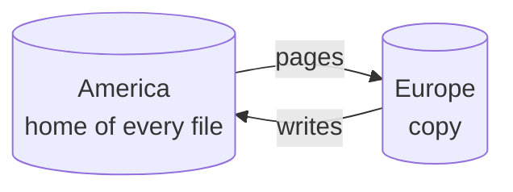

# Readers in another region

The chat's users are in America and Europe. Every read from Europe crosses
the ocean, about 100 ms each way, and the chat feels slow there. This chapter
puts a copy of the store's files in Europe: reads become local, and writes
still go to the one machine that writes each file. TinyStore calls every
store a node; a node holds the files it asks for, writes some of them, and
serves them to other nodes.

> [!NOTE]
> **Built, with draft names**
> Nodes, copies and writes passed to a file's home are built. The names of
> their options may change before `v0.1.0`.

## One home per file

Every file has one home: the node that writes it. Every other node holding the
file holds a copy, which only readers and the replication engine open. A copy
receives the home's commits as pages, in order, and applies each one whole.



A copy of a file is the home's file page for page after each commit it
applies, and a reader of the copy never sees half a commit (contract
REPL-04). It may be behind its home by the time the pages take to arrive
(contract REPL-05).

## Start two nodes

```sh
# America: the home, where the chat was deployed and its migrations run
tinystore serve ./us --node-listen 0.0.0.0:7444 --node-config node.toml

# Europe: copies every file from America, and serves the programs in Europe
tinystore serve ./eu --from us.internal:7444 --node-listen 0.0.0.0:7444 --node-config node.toml
```

```toml title="node.toml"
token-file = "/etc/tinystore/node-token"   # the token that nodes show each other
advertise = "eu.internal:7444"             # where other nodes reach this one

[tls]
cert = "/etc/tinystore/node.pem"
key = "/etc/tinystore/node.key"
roots = "/etc/tinystore/ca.pem"
```

A link between two machines takes TLS. A node with no `[tls]` refuses a link
beyond its own machine unless its config says `insecure = true` (contract
REPL-11). Anyone who reaches a node's port can open a link, so the node closes
one that has not shown its token within ten seconds, or that sends more than
64 KiB before it does, and holds at most 64 such links at once. The European
chat processes open `./eu` as they open any store, through its sidecar, so
their code does not change.

A Bun program can be a node itself, with its store inside it:

```ts
const store = await open('./data', { embedded: true, node: { from: ['eu.internal:7444'], token } })
```

## Reads are local

```ts
const session = await sessions.under(userId).get(digest(token)) // read from Europe's copy
const page = await messages.where({ chat_id: chatId }).orderBy('id', 'desc').list({ limit: 50 })
```

Every read, a key, a page of messages, a search, a log query, runs on the
local copy. Nothing crosses the ocean, with one exception.

A `get`, `entry` or `has` of an idle key that is due for renewal sends the
renewal to the home (see [Expiry](../../guides/kv/expiry.md#idle-keys)). The
copy sends it in the background, together with other renewals, once a
second, so the read doesn't wait. If the key has less than a minute left, the
read waits for the home's answer, for at most 5 seconds, so that the key
doesn't expire. If no link reaches the home, the read doesn't wait at all,
and the copy sends the renewal when the link is back.

## Writes go home

A write on a copy is passed to the file's home. The home commits it, the
pages come back, and the call answers once the local copy holds the commit:

```scene
code ts
  await sessions.under(userId).set(digest(token), session)
end
actor app  "Chat in Europe" at 8,50  icon=server
actor eu   "Europe copy"    at 42,50 icon=database
actor us   "America home"   at 88,50 icon=globe
link app eu
link eu us
mark eu copy
mark us home
set eu "commit 411"
set us "commit 411"

step "A user signs in in Europe. The chat sets the session on Europe's copy of kv.db." line=1
  send app -> eu "set"

step "Europe cannot write a copy. It passes the write to America, the file's home." line=1
  send eu -> us "set" 

step "America commits it as commit 412, and sends the commit's pages to Europe." line=1
  set us "commit 412"
  send us -> eu "pages of 412"
  set eu "commit 412"

step "Europe's copy now holds commit 412, so the set answers. A get right after it sees the session." line=1
  send eu -> app "done" color=ok
```

A write on a copy passes to its home and answers once the copy holds it
(contract REPL-06). The program reads its own writes: a `get` right after a
`set` sees it. The cost is one round trip to the home.

| Write                           | Where it lands                                | Its cost                                          |
|---------------------------------|-----------------------------------------------|---------------------------------------------------|
| a read                          | the local copy                                | nothing                                           |
| a read's renewal of an idle key | the home, sent once a second                  | nothing; in the key's last minute, one round trip |
| a counter's `add`               | a local queue, sent to the home, counted once | nothing; it answers at once                       |
| a set, an insert, a job's add   | the home, then back as pages                  | one round trip to the home                        |
| a transaction                   | refused on a copy: run it at the home         | —                                                 |

A counter's add answers at once, because two adds give the same total in any
order. The node keeps the add in a queue of its own and sends it to the home
with an id, so an add sent twice after a lost link counts once (contract
REPL-12).

## Writes that must not wait for the ocean

A write on a copy pays the round trip to its home. A file whose writers are
in one region can have its home there instead: each node writes the files it
makes. Give the chat's European tenants a database of their own, made by the
European node, and its home is Europe:

```ts
const tenant = await store.database(`tenant-${tenantId}`, { migrations }) // made here, written here
```

A catalog, `catalog.db`, names the home of every file. One node a person
chooses keeps it, `catalog = true` in its config; a node that makes a file
claims its name there first, so two nodes never make the same file.

## When a home's disk must not lose a commit

By default a home answers a write after its own commit, and its copies
trail. With `synchronous = true` in the home's config, a write answers only
once a copy holds it on its disk. Losing the home then loses nothing it
answered. A commit that no copy held within five seconds still stands in the
home's file, and answers `committed locally` instead of plain success,
because losing that home's disk would lose it (contract REPL-09).

## Why this design?

**Why pages and not operations.** A copy could receive the operations, "set
key 42", and apply them itself. Then every engine would need replication of
its own, and a copy whose engine version differs could compute another
result. Pages are the result: the copy's file becomes the home's file, byte
for byte, whatever engine wrote it, migrations and indexes included.

**Why one home and no merging.** Two homes of one file would have to merge
two versions of a page, and SQLite's pages cannot be merged. Systems that
accept writes on both sides of a cut cable pay with conflicts that the
program must resolve. TinyStore keeps one writer per file and puts each
file's home where its writers are.

**Why the network is the core's.** The links run on the store's own threads,
so a store inside a Bun or Python program is the same node as a server. A
small service can hold a copy of the one database it reads, with no sidecar
and no extra process.

## See also

- [When the home dies](home-dies.md): moving a home, and promoting a copy.
- [The server](server.md): serving a store to programs on other machines.
