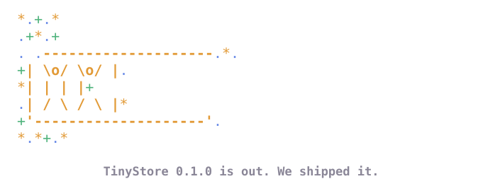

# TinyStore 0.1.0

TinyStore 0.1.0 came out on 20 October 2026. It is the first release: one
core in Rust with every engine, and SDKs for Bun and Node, Python and Go, on
npm, PyPI, crates.io and GHCR.



We shipped it. [Your first store](../handbook/start/first-store.md) is the
place to start, and the
[GitHub release](https://github.com/tinyshed/tinystore/releases/tag/v0.1.0)
lists what it holds.

## Install

```sh for=bun
bun add @tinyshed/tinystore@0.1.0
```

```sh for=python
pip install tinyshed-tinystore==0.1.0
```

```sh for=go
go get tinyshed.org/tinystore@v0.1.0
```

```sh for=rust
cargo add tinystore@0.1.0
```
