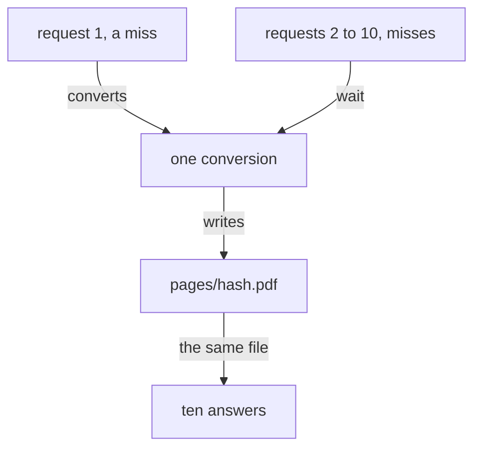

# TinyStore 0.10.0

TinyStore 0.10.0 came out on 17 November 2026. A set of files can now be a
real cache: files people read stay, files nobody reads go, and the whole set
never grows past the size you give it. Ten requests that miss the same file
at once run your conversion once. The same ceiling, set to refuse, is a quota
for a user's uploads.

- **Blobs**
  - [A cache that holds its size](#a-cache-that-holds-its-size): `idle` and `maxSize` on a set of files.
  - [One conversion for ten requests](#one-conversion-for-ten-requests): `getOrCreate`.
  - [A quota that says no](#a-quota-that-says-no): `whenFull: 'refuse'`.
  - [Change the ceiling, free room now](#change-the-ceiling-free-room-now): `setMaxSize` and `trim`.
  - [See what the cache is worth](#see-what-the-cache-is-worth): `usage()`, metrics and `status --names`.

## A cache that holds its size

A program converts office documents to PDF pages and keeps the pages, keyed
by a hash of the source. Until now a set of files could expire them, but only
counting from the write: the lecture opened every day of the semester went
after 30 days and was converted again, while pages nobody opened sat there
the whole month. And nothing kept the set from filling the disk.

Now a file's term counts from its last read, and the set has a ceiling
([Caching](../guides/blobs/caching.md)):

```ts
const cache = await store.database('cache', { backup: false })
const pages = cache.files('pages', { idle: '30d', maxSize: '512MiB' })

await pages.put(`${hash}.pdf`, pdf, { contentType: 'application/pdf' })
const page = await pages.get(`${hash}.pdf`) // lives another 30 days from this read
```

```python
cache = await store.database("cache", backup=False)
pages = cache.files("pages", idle="30d", max_size="512MiB")

await pages.put(f"{hash}.pdf", pdf, content_type="application/pdf")
page = await pages.get(f"{hash}.pdf")  # lives another 30 days from this read
```

```go
cache, err := sqldb.Open(ctx, store, "cache", sqldb.Backup(false))
pages, err := blobs.OpenFiles(cache, "pages", blobs.Idle(30*24*time.Hour), blobs.MaxSize(512<<20))

_, err = pages.Put(ctx, hash+".pdf", bytes.NewReader(pdf), blobs.ContentType("application/pdf"))
page, found, err := pages.Get(ctx, hash+".pdf") // lives another 30 days from this read
```

```rust
let cache = store.database("cache").backup(false).open()?;
let pages = cache.files("pages").idle(Duration::from_hours(24 * 30)).max_size(512 << 20).open()?;

pages.key(&format!("{hash}.pdf")).content_type("application/pdf").put(&pdf)?;
let page = pages.get(&format!("{hash}.pdf"))?; // lives another 30 days from this read
```

- `get` and `head` renew a file, so a `304` answered from its ETag counts as
  a use. A renewal is written about once a day for a 30-day term, as kv's
  idle keys do, so reads stay reads.
- A write that takes the set past `maxSize` removes files to make room and
  never fails because the set is full.
- Which files go: the ones written and never read since, then the ones read
  least recently. A read gives a file a day's head start. That head start is
  what keeps a crawler or a script that reads every file once from pushing
  out the pages people come back to: research measured it against plain LRU
  on the same traffic, 6 to 8 points more hits the day after a crawl and
  never fewer elsewhere ([the round](https://github.com/tinyshed/research/blob/main/tinystore/reports/files-cache-eviction-2026-11-17.md)).
- The ceiling is kept in the set, not in the handle, so a second program that
  opens `pages` without options follows it too.

## One conversion for ten requests

A new document gets shared in a chat and ten people open it in the same
second. Every request misses the cache, so all ten start a conversion. With
`getOrCreate`, the first request converts and the other nine wait for its
file ([Get or create](../guides/blobs/get-or-create.md)):

```ts
const page = await pages.getOrCreate(`${hash}.pdf`, async () => ({ data: await convert(doc), contentType: 'application/pdf' }))
return new Response(page.stream(), { headers: { etag: page.etag } })
```

```python
from tinystore import Fill

page = await pages.get_or_create(f"{hash}.pdf", lambda: Fill(convert(doc), content_type="application/pdf"))
```

```go
page, err := pages.GetOrCreate(ctx, hash+".pdf", func(ctx context.Context) (blobs.Fill, error) {
	pdf, err := convert(ctx, doc)
	return blobs.Fill{Data: pdf, ContentType: "application/pdf"}, err
})
```

```rust
let page = pages.key(&format!("{hash}.pdf")).content_type("application/pdf").get_or_create(|| convert(&doc))?;
```



It waits across processes too: requests that reach the store through its
server wait for a conversion running in another client. A conversion of ten
minutes keeps its claim on the key; a process that dies mid-way gives it up
at once. A result lands only while its run still holds the key, so a slow
run that lost it never overwrites a newer file, and a `delete` of the key
during a conversion means that conversion is stale and runs again. When the
function throws, every request that waited gets that error, so one broken
document costs one conversion, not ten.

## A quota that says no

The same ceiling, for files that must not go: a user's uploads. A write past
it fails `limit` and removes nothing:

```ts
const uploads = db.files('uploads', { maxSize: '500MiB', whenFull: 'refuse' })
```

```python
uploads = db.files("uploads", max_size="500MiB", when_full="refuse")
```

```go
uploads, err := blobs.OpenFiles(db, "uploads", blobs.MaxSize(500<<20), blobs.WhenFull(blobs.Refuse))
```

```rust
let uploads = db.files("uploads").max_size(500 << 20).when_full(WhenFull::Refuse).open()?;
```

Replacing a file counts the difference, so writing a smaller file over a
larger one always lands, and deletes and expiry free room as usual.

## Change the ceiling, free room now

Opening a set never changes its ceiling: an open with another `maxSize` fails
`conflict`. Otherwise a rolling deploy, old servers at 512 MiB and new ones
at 1 GiB, would move the ceiling back and forth with every open and evict
files each time it went down. A ceiling changes by one call that says what it
replaces:

```ts
await pages.setMaxSize('1GiB', { ifCurrent: '512MiB' })
const { evictions, freed } = await pages.trim({ to: '300MiB' })
```

```python
await pages.set_max_size("1GiB", if_current="512MiB")
trimmed = await pages.trim(to="300MiB")
```

```go
err = pages.SetMaxSize(ctx, 1<<30, blobs.IfCurrent(512<<20))
trimmed, err := pages.Trim(ctx, 300<<20)
```

```rust
pages.set_max_size(1 << 30).if_current(512 << 20).apply()?;
let trimmed = pages.trim(300 << 20)?;
```

`setMaxSize` to the ceiling the set already has writes nothing, so every
instance of a deploy can call it at its start. `trim` frees room once, in the
same order eviction uses, and leaves the ceiling as it is. Both are on the
command line too: `tinystore files set-max-size` and `tinystore files trim`.

## See what the cache is worth

```ts
const { count, size, maxSize, evictions } = await pages.usage()
```

- `evictions` counts what the ceiling removed since the store opened. A full
  set with few evictions has its ceiling right; a fast-growing count says it
  is too low.
- The store's own metrics gain `tinystore_files_bytes{set}`,
  `tinystore_files_evicted_total{set}` and
  `tinystore_files_get_or_create_total{set, outcome}`. `hit` and `wait`
  against `run` say how many conversions the cache saved.
- `tinystore status --names` prints a set's size against its ceiling, as
  `498 MiB / 512 MiB`, and `tinystore verify` checks that the set's counters
  match its files.
- Nothing that looks at the cache from outside, the command line, MCP or a
  `read` token, renews a file or moves it in the order.

## Install

```sh for=bun
bun add @tinyshed/tinystore@0.10.0
npm install @tinyshed/tinystore@0.10.0
```

```sh for=python
pip install tinyshed-tinystore==0.10.0
```

```sh for=go
go get tinyshed.org/tinystore@v0.10.0
```

```sh for=rust
cargo add tinystore@0.10.0
cargo install tinystore-cli@0.10.0
```

0.10.0 adds two steps to `blobs.db`'s migrations, and two to a database's
files, so 0.9.0 refuses a store that 0.10.0 has opened rather than read it
wrong. Open it with 0.10.0 or later. What a program gets over the wire comes
once the server is 0.10.0. The server image is
`ghcr.io/tinyshed/tinystore:0.10.0`.

Every commit since 0.9.0 is in the
[GitHub release](https://github.com/tinyshed/tinystore/releases/tag/v0.10.0).
