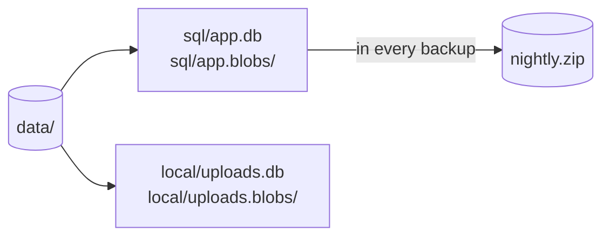

# TinyStore 0.9.0

TinyStore 0.9.0 came out on 16 November 2026. The store can now index a
folder it doesn't own, a film library or a photo archive, and serve its
files without copying a byte. A database can stay out of every backup, a
backup can be checked without restoring it, and `each()` really walks
tables bigger than memory. Jobs without an id can be cancelled and counted,
a scraped NaN no longer breaks a metrics panel, and a search index tells you
when its upkeep keeps failing.

- **Blobs**
  - [Folders you don't own](#folders-you-dont-own): `store.directory` lists, follows and serves a folder on disk.
- **SQL**
  - [Uploads that skip the backup](#uploads-that-skip-the-backup): `backup: false` keeps a database out of every backup.
  - [Every row, past 64 MiB](#every-row-past-64-mib): `each()` streams rows instead of loading them all.
- **Backup**
  - [Check a backup without restoring it](#check-a-backup-without-restoring-it): `tinystore verify`.
- **Jobs**
  - [Cancel a job that has no id](#cancel-a-job-that-has-no-id): `cancel(job)` takes the job a list gave.
  - [How many jobs are in each state](#how-many-jobs-are-in-each-state): `counts()`.
- **Metrics**
  - [NaN from an exporter](#nan-from-an-exporter): `skipNaN` passes over an idle summary's NaN.
- **Search**
  - [Upkeep that keeps failing](#upkeep-that-keeps-failing): `status()` carries the error.
- **Server**
  - [A cap on remote connections](#a-cap-on-remote-connections): `--max-connections`.

> [!WARNING]
> **Rust: a search index's `Status::Ready` has a field**
> `Status::Ready` and `Status::Rebuilding` gain `error`, so a `match` on
> them names it or skips it:
>
> ```diff
> - Status::Ready => serve(),
> + Status::Ready { .. } => serve(),
> ```
>
> **Bun, Node and Python: `all()` of a queue goes on past a broken job**
> A job whose value no longer reads used to stop `all()` for good. Now the
> walk throws `CorruptError` for that job, and the same loop, run again,
> carries on after it. A loop that let the error end the program still does.

## Folders you don't own

A film library is two terabytes that something else owns. Copying it into
`blobs/` is out of the question, so until now TinyStore couldn't serve it at
all. A directory lists a folder, writes down what changed since the last
look, and reads its files from where they lie
([Directories](../guides/blobs/directories.md)):

```ts
const movies = store.directory('movies', { path: 'D:/Movies', every: '15m' })

const scan = await movies.scan() // { added: 3, changed: 1, removed: 0, skipped: 0, count: 1842, size: 2104332118016 }
const page = await movies.changes({ after: cursor }) // { items: [{ path, change, info }], next }
const file = await movies.get('Dune (2021)/Dune.mkv') // StoredFile | undefined
```

```python
movies = store.directory("movies", path="D:/Movies", every="15m")

scan = await movies.scan()  # Scan(added=3, changed=1, removed=0, skipped=0, count=1842, size=2104332118016)
page = await movies.changes(after=cursor)  # Changes(items, next)
file = await movies.get("Dune (2021)/Dune.mkv")  # StoredFile | None
```

```go
movies, err := blobs.OpenDirectory(store, "movies", "D:/Movies", blobs.Every(15*time.Minute))

scan, err := movies.Scan(ctx)                               // blobs.Scan{Added, Changed, Removed, Skipped, Count, Size}
page, err := movies.Changes(ctx, blobs.After(cursor))       // blobs.Changes{Items, Next}
file, found, err := movies.Get(ctx, "Dune (2021)/Dune.mkv") // *blobs.StoredFile
```

```rust
let movies = store.directory("movies").path("D:/Movies").every(Duration::from_mins(15)).open()?;

let scan = movies.scan()?; // Scan { added, changed, removed, skipped, count, size }
let page = movies.changes().after(&cursor).page()?; // Changes { items, next }
let file = movies.get("Dune (2021)/Dune.mkv")?; // Option<StoredFile>
```

- **The store never writes in the folder.** No call creates, renames or
  deletes anything under the path.
- **A file is the `StoredFile` you already serve**: ranges, `If-None-Match`
  and Go's `ServeContent` work as they do for stored files. Its ETag names
  the file's size and time, not a hash of its bytes.
- **A scan is cheap.** Over a million files that changed nothing it takes
  about 4 seconds and 7 MiB, measured on NTFS and ext4, so `every: '15m'`
  costs under half a percent of one core.
- **A file still being written**, a download or a camera's recording, plays
  in a directory opened `growing: true`. Elsewhere a file that changes under
  a read fails `conflict`, so a range never mixes two versions of a film.
- **Over a server**, the server's owner names the folders,
  `tinystore serve … --directory movies=/mnt/media`, and a client with a
  token can't ask for any other path.

### A disk that drops off

A USB disk unplugged, or a share gone offline, looks like an empty folder.
A scan that believed it would tell the program every film was removed, and
a catalog built on those changes would forget its library.

```scene
code ts
  const movies = store.directory('movies', { path: '/mnt/films', every: '15m' })
  const scan = await movies.scan()
end
actor app   "Media app"  at 10,50 icon=monitor
actor store "TinyStore"  at 50,50 icon=database
actor disk  "USB disk"   at 90,50 icon=hard-drive
link app store
link store disk
set store "1,842 films listed"

step "Every 15 minutes the store scans the folder and finds nothing new." line=1-2
  send store -> disk "scan"
  send disk -> store "1,842 files" color=ok
step "Someone pulls the USB disk out. The folder is now empty." line=2
  cut store disk
  set disk "unplugged"
  send store -> disk "scan" lost
step "The scan refuses instead of removing 1,842 films." line=2
  send store -> app "unavailable" color=bad
  set store "1,842 films listed"
step "The disk comes back, and the next scan finds the same films." line=2
  link store disk
  set disk "mounted"
  send store -> disk "scan"
  send disk -> store "1,842 files" color=ok
```

A scan that can't read the folder, or finds it empty while its list is not,
fails `unavailable` and changes nothing (contract BLOB-12). A scan also
stays on the folder's own disk: a disk mounted inside it is a directory of
its own, so when that disk drops off, nothing of the outer one is told
removed.

## Uploads that skip the backup

A student uploads a report, and it waits fifteen minutes for them to
confirm. It should not sit in the nightly backup for months
([#63](https://github.com/tinyshed/tinystore/issues/63)). A database opened
with `backup: false` is left out of every backup, with every file kept in
it ([A database no backup takes](../guides/sql/README.md#a-database-no-backup-takes)):

```ts
const uploads = await store.database('uploads', { backup: false })
const pending = uploads.files('pending', { ttl: '15m' })
const backup = await store.backup('nightly.zip') // { files, bytes, keyLeftOut, excluded: ['uploads'] }
```

```python
uploads = await store.database("uploads", backup=False)
pending = uploads.files("pending", ttl="15m")
backup = await store.backup("nightly.zip")  # Backup(files, bytes, key_left_out, excluded=['uploads'])
```

```go
uploads, err := sqldb.Open(ctx, store, "uploads", sqldb.Backup(false))
pending, err := blobs.OpenFiles(uploads, "pending", blobs.TTL(15*time.Minute))
backup, err := store.Backup(ctx, "nightly.zip") // tinystore.Backup{…, Excluded: []string{"uploads"}}
```

```rust
let uploads = store.database("uploads").backup(false).open()?;
let pending = uploads.files("pending").ttl(Duration::from_mins(15)).open()?;
let backup = store.backup().write("nightly.zip")?; // Backup { excluded: ["uploads"], … }
```

The rule lives in where the file lies, not in a setting someone has to
remember:



- **No backup takes it**: not this release's, not `tinystore backup` in
  another process, and not one released before, since none of them ever
  looks in `local/` (contract BAK-05).
- **It is this machine's own.** On a network of nodes, no node copies it,
  so an upload made on one node is not on another.
- A restore has no `uploads`; the program opens it again, empty.

## Every row, past 64 MiB

The guide always said `each()` reads "more than fits in memory", but the
server read every row first and failed at 64 MiB like `all()`. Now rows
stream a part at a time, and Rust gets `each()` too
([Every row, one at a time](../guides/sql/tables.md#every-row-one-at-a-time)):

```ts
for await (const order of orders.orderBy('id').each()) await exportRow(order)
```

```python
async for order in orders.order_by("id").each():
    await export_row(order)
```

```go
for order, err := range orders.OrderBy("id", sqldb.Asc).Each(ctx) {
	err = exportRow(order)
}
```

```rust
for order in orders.order_by("id", Direction::Asc).each()? {
    export_row(&order?)?;
}
```

- Memory holds a couple of parts, not the rows: a walk of ten million rows
  costs what a walk of ten thousand does (contract SQL-13).
- One snapshot lasts 5 seconds at most. A walk ordered by a unique key reads
  on after that, from the last row it gave; any other walk fails `limit`
  there and names `list`.

## Check a backup without restoring it

A backup nobody tried is a hope. `tinystore verify` makes every check a
restore makes, sizes, CRC-32 and SHA-256, and writes nothing
([Check a backup without restoring it](../guides/backup/restore.md#check-a-backup-without-restoring-it)):

```sh
tinystore verify backups/chat-2026-11-16.zip
```

```text
● backups/chat-2026-11-16.zip  ok · 3 files · 52 KiB · checked in 0.1s
  a restore of it writes 53248 bytes
```

A file that doesn't match exits 1 and names it, so a nightly job can check
its own zip. In Rust it is `tinystore::backup::verify(path)`.

## Cancel a job that has no id

Most jobs are added without an id, and until now nothing could take one
back. `cancel` takes the job a list gave
([Cancel a job without an id](../guides/jobs/ids.md#cancel-a-job-without-an-id)):

```ts
for await (const job of emails.all({ state: 'scheduled' })) {
	if (job.value.to === 'typo@example.com') await emails.cancel(job)
}
```

```python
async for job in emails.all(state="scheduled"):
    if job.value.to == "typo@example.com":
        await emails.cancel(job)
```

```go
for job, err := range emails.All(ctx, jobs.Scheduled) {
	if err == nil && job.Value.To == "typo@example.com" {
		_, err = emails.CancelJob(ctx, job)
	}
}
```

```rust
for job in emails.all(Filter::default().state(State::Scheduled)) {
    let job = job?;
    if job.value.to == "typo@example.com" {
        emails.cancel(&job)?;
    }
}
```

It answers `false` if the job ran, moved to a retry or was cancelled since
the list, and never cancels another job in its place (contract JOB-15).

## How many jobs are in each state

The first thing a dashboard shows about a queue:

```ts
const counts = await emails.counts() // { scheduled: 120, waiting: 8, running: 2, failed: 3 }
```

```python
counts = await emails.counts()  # JobCounts(scheduled=120, waiting=8, running=2, failed=3)
```

```go
counts, err := emails.Counts(ctx) // jobs.Counts{Scheduled: 120, Waiting: 8, Running: 2, Failed: 3}
```

```rust
let counts = emails.counts()?; // Counts { scheduled: 120, waiting: 8, running: 2, failed: 3 }
```

All four come from one snapshot (contract JOB-16), and the count reads no
job's value. `tinystore jobs ./data counts emails` prints the same.
[How many jobs are in each state](../guides/jobs/ids.md#how-many-jobs-are-in-each-state)
has the details.

## NaN from an exporter

A Prometheus summary writes `NaN` for a quantile while a service is idle,
and one NaN failed every aggregate over its range, so a scraped panel stayed
blank. `skipNaN` passes those samples over and says how many
([NaN from an exporter](../guides/metrics/aggregates.md#nan-from-an-exporter)):

```ts
await store.metrics.aggregate({ name: 'rpc_seconds', since: '1h', every: '1m', op: 'avg', by: ['quantile'], skipNaN: true })
// buckets: [{ at, value: 0.21, samples: 3, skipped: 1 }, …]
```

```python
await store.metrics.aggregate(name="rpc_seconds", since="1h", every="1m", op="avg", by=["quantile"], skip_nan=True)
```

```go
metrics.Aggregate(ctx, store, metrics.Query{Name: "rpc_seconds", Since: time.Hour, Every: time.Minute,
	Op: metrics.Avg, By: []string{"quantile"}, SkipNaN: true})
```

```rust
stats.query().name("rpc_seconds").since(Duration::from_hours(1)).every(Duration::from_mins(1))
    .by(&["quantile"]).skip_nan().aggregate(Op::Avg)?;
```

A bucket of NaN alone has no value, never a zero, and an infinity is still
refused (contract MET-23). The samples stay stored bit for bit.

## Upkeep that keeps failing

A search index merges and cleans itself in the background. When that kept
failing, a merge on a full disk say, only the log said so once.
`status()` now carries the error for as long as it lasts
([When maintenance fails](../guides/search/rebuilds.md#when-maintenance-fails)):

```ts
await docs.status() // { state: 'ready', error: 'merge: disk full' }
```

```python
await docs.status()  # IndexStatus(state='ready', done=0.0, error='merge: disk full')
```

```go
status, err := docs.Status(ctx) // search.Status{State: search.Ready, Error: "merge: disk full"}
```

```rust
docs.status()? // Status::Ready { error: Some("merge: disk full") }
```

The index still answers searches, and `ready()` waits as it did (contract
SRCH-16). A full disk also no longer fails a rebuild for good: the rebuild
waits, and goes on once there is room.

## A cap on remote connections

```sh
tinystore serve ./data --listen tls://0.0.0.0:7443 --tls-cert cert.pem --tls-key key.pem --tokens tokens.txt --max-connections 256
```

The 257th client is told `limit`, naming the cap, and every SDK fails its
connect with that message (contract WIRE-12). Programs on the same machine,
through the local socket, are not counted. Without the flag a server serves
as many as come, as before
([serve](../guides/cli/serve.md)).

## Changed names

- Rust: `search::Status::Ready` and `Status::Rebuilding` gain `error`:

  ```rust
  Status::Ready => serve(),       // 0.8.0
  Status::Ready { .. } => serve(), // 0.9.0
  ```

- Rust: `jobs::Job` gains a private field that names its row, so a `Job`
  can no longer be built by a struct literal. Programs get jobs from a
  queue, so this touches only tests that built one.
- Bun, Node and Python: `all()` of a queue throws `CorruptError` for a job
  whose value no longer reads and goes on after it when looped again,
  where it stopped for good.

## Fixes

- `each()` in Bun and Node, Python and Go read every row before the first
  and failed `limit` at 64 MiB; it streams them now.
- A full disk while a search index switched to new settings failed its
  rebuild for good, until the index's next change.
- The library built with `replication` and `sql` but no `kv` or `jobs`
  did not compile.
- Every package's README said version 0.3.

## Install

```sh for=bun
bun add @tinyshed/tinystore@0.9.0
npm install @tinyshed/tinystore@0.9.0
```

```sh for=python
pip install tinyshed-tinystore==0.9.0
```

```sh for=go
go get tinyshed.org/tinystore@v0.9.0
```

```sh for=rust
cargo add tinystore@0.9.0
cargo install tinystore-cli@0.9.0
```

0.9.0 adds a step to `blobs.db`'s migrations for directories, so 0.8.0
refuses a store that 0.9.0 has opened rather than read it wrong. Open it
with 0.9.0 or later. What a program gets over the wire comes once the server
is 0.9.0. The server image is `ghcr.io/tinyshed/tinystore:0.9.0`.

Every commit since 0.8.0 is in the
[GitHub release](https://github.com/tinyshed/tinystore/releases/tag/v0.9.0).
